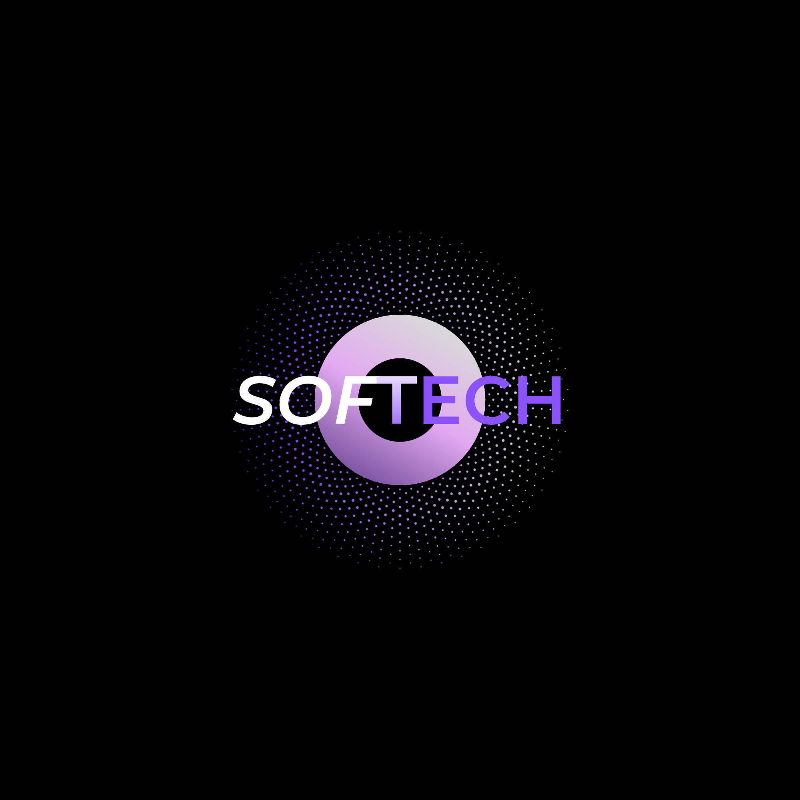

<p align="center">
  
</p>

<h1 align="center">Sistema de Gestión Logística y Distribución</h1>

<p align="center">
  <strong>Proyecto de Cátedra — Ingeniería de Software</strong><br>
  Facultad de Informática — Universidad Nacional de La Plata (UNLP)<br>
  <em>Equipo de Desarrollo: Softech</em>
</p>

---

## 📌 Acerca del Proyecto

Este repositorio contiene la ingeniería de requisitos, documentación de diseño arquitectónico y el desarrollo del software para la optimización de procesos operativos, gestión de pedidos y circuito de cobranzas de un **centro de distribución logística tercerizada**.

### Contexto del Negocio y Cliente
- **Stakeholder / Cliente:** Martín Rodríguez (Operaciones Logísticas).
- **Actividad:** Distribución tercerizada de productos de consumo masivo (bebidas) cubriendo partidos de la zona sur del Gran Buenos Aires.
- **Canal destinatario:** Comercio minorista tradicional de cercanía (kioscos, almacenes y autoservicios de proximidad).
- **Desafío central:** Digitalizar la interacción comercial (reduciendo la fricción del uso de WhatsApp), automatizar la confección de hojas de ruta y optimizar el control de cobranzas en efectivo y billeteras electrónicas.

---

## 👥 Integrantes — Equipo Softech

El equipo está conformado por 7 integrantes, organizados en subgrupos de desarrollo y gestión ágil:

- **Enzo Giandon** (03532/4) — Scrum Master / Facilitación y Gestión Ágil
- **Alan Tolaba** (4122/3) — Front Administrativos (Web)
- **Ian Chica Herrero** — Front Administrativos (Web)
- **Catalina Caruso** (03298/4) — Front Transportistas (Mobile)
- **Aylén Carlos** (03538/0) — Front Transportistas (Mobile)
- **Lautaro Giralde** (03568/7) — Backend y Persistencia
- **Mayerly Sinion Mendoza** — Backend y Persistencia

---

## 📂 Estructura del Repositorio

La organización del proyecto sigue una estricta separación de responsabilidades para garantizar mantenibilidad tanto en la etapa documental como en la fase de implementación:

```text
Proyecto_Ing-software/
├── assets/                             # Identidad visual y recursos gráficos
│   └── logos/                          # Logotipos oficiales de Softech
├── docs/                               # Documentación de ingeniería y gestión
│   ├── entregas/                       # Paquetes formales de entregas para la cátedra
│   │   ├── README.md                   # Resumen del estado de entregas del cuatrimestre
│   │   ├── entrega-01/                 # Entrevistas + Cuestionario + Req. no funcionales (Finalizada)
│   │   └── entrega-02/                 # Iniciativas + Épicas + HU (Taiga) + PGP (Finalizada)
│   ├── entrevistas/                    # Ciclo de entrevistas y relevamiento de campo
│   │   ├── README.md                   # Resumen del ciclo y accesos a audios en la nube
│   │   ├── entrevista-01/              # Relevamiento operativo y modelo de negocio
│   │   └── entrevista-02/              # Requisitos de software y circuito financiero
│   └── gestion/                        # Minutas internas, debates de equipo y pautas metodológicas
│       ├── notas-preparacion.md        # Apuntes de preparación metodológica
│       ├── debate-entrevistas.md       # Acuerdos y dinámicas grupales
│       ├── comunicacion-kristian.md    # Registro de comunicaciones
│       ├── plantilla-scrum.md          # Plantilla estándar para ceremonias Scrum (#XX)
│       └── sprint-01/                  # Planificación y actas de reuniones del Sprint 1
│           ├── README.md               # Resumen del Sprint 1, métricas y estado
│           ├── sprint-planning-01.md   # Acta de Planning y compromiso (28 HUs - 71 pts)
│           ├── daily-scrum-01.md       # Scrum #1: Validación con cliente Martín Rodríguez
│           ├── daily-scrum-02.md       # Scrum #2: Sincronización técnica interna y bloqueos
│           ├── daily-scrum-03.md       # Scrum #3: Avance en código, consolidación de apps backend y estilos
│           └── assets/                 # Capturas de maquetas y logotipos de minutas
└── src/                                # Código fuente del sistema (en desarrollo)
```

---

## 🚀 Estado del Proyecto y Hoja de Ruta

- [x] **Fase 1: Relevamiento y Validación Operativa (Entrevista 1)**
  - Relevamiento de infraestructura, flota de camiones, centros de acopio y perfil de clientes.
- [x] **Fase 2: Definición de Requisitos y Circuito de Cobranzas (Entrevista 2)**
  - Definición de alternativas a WhatsApp, roles del sistema y gestión del efectivo.
- [x] **Fase 3: Especificación de Requerimientos y Backlog Ágil (Entrega 2)**
  - Iniciativas y épicas funcionales (EP-01 a EP-07), 51 HUs en Taiga (148 pts) y Plan de Gestión de Proyecto (PGP - IEEE 1058).
- [x] **Fase 4: Diseño UX/UI y Prototipado Interactivo (Figma)**
  - Vistas administrativas web por rol y app móvil Android (login, itinerario, recorridos y cobros).
- [ ] **Fase 5: Construcción e Implementación del Sistema (Sprint 1 en curso)**
  - Sprint 1 (09/10 al 29/10/2026): 28 HUs comprometidas (71 pts). Hacia la Demo 1 (MVP Iteración 1 — 30/10/2026).
  - Sprint 2 (30/10 al 20/11/2026): 23 HUs remanentes (77 pts). Hacia la Demo 2 (Release Final).

---

## 📄 Licencia y Uso Académico

Documentación y código desarrollados con fines exclusivamente académicos en el marco de la carrera de Ingeniería en Computación de la UNLP.
