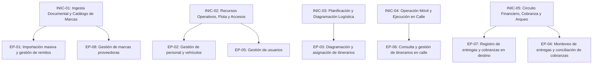

# Documento de Iniciativas Estratégicas y Épicas Funcionales (Entrega 2)

**Proyecto:** Sistema Integral de Gestión Logística y Liquidación de Cobranzas (RepartoYA)  
**Cliente:** Centro de Distribución Logística (Martín Rodríguez, Responsable de Planificación y Rutas)  
**Consultora de Software:** Softech  
**Equipo:** Enzo Giandon, Alan Tolaba, Catalina Caruso, Ian Chica Herrero, Lautaro Giralde, Mayerly Sinion Mendoza, Aylén Carlos  
**Fecha de Actualización:** 20 de noviembre de 2026  
**Estado:** Sincronizado integralmente con el tablero oficial de Taiga (`epics.csv` y `userstories.csv`)  

---

## 🎯 1. Introducción y Marco Estratégico

El presente documento formaliza la descomposición funcional del **Sistema Integral de Gestión Logística y Liquidación de Cobranzas**, estructurado en **Grandes Iniciativas Estratégicas de Negocio** y **Épicas Funcionales**. 

Esta jerarquía garantiza la cobertura punta a punta del ciclo operativo del centro de distribución:
1. **Fase Nocturna / Madrugada:** Ingesta de pedidos de marcas proveedoras, saneamiento documental y diagramación de hojas de ruta e itinerarios.
2. **Fase Matutina / Campo:** Ejecución de visitas en calle por transportistas mediante app móvil, validación de entregas y recaudación multicanal (efectivo, transferencias, QR).
3. **Fase Vespertina / Cierre:** Retorno de flota, validación contable de pagos, resolución de diferencias y arqueo de caja con bitácora de auditoría.

---

## 🏛️ 2. Iniciativas Estratégicas del Negocio

### INIC-01: Ingesta Automatizada y Trazabilidad Documental de Marcas Proveedoras
* **Objetivo de Negocio:** Habilitar un canal confiable y transaccional para la carga masiva y manual de remitos comerciales provistos por las marcas abastecedoras del centro de distribución, controlando la unicidad compuesta (`marca + número de remito`) y la integridad referencial.
* **Épicas Vinculadas:** 
  * `EP-01 (#1)`: Importación masiva y gestión de remitos (Web).
  * `EP-08 (#251)`: Gestión de marcas proveedoras (Web).

### INIC-02: Gestión Centralizada de Recursos, Flota y Seguridad de Acceso
* **Objetivo de Negocio:** Proveer al área administrativa control estricto sobre el padrón de transportistas, vehículos habilitados, políticas de seguridad, autenticación y recuperación de credenciales operativas.
* **Épicas Vinculadas:**
  * `EP-02 (#6)`: Gestión de personal y vehículos (Web).
  * `EP-05 (#51)`: Gestión de usuarios (Web).

### INIC-03: Ruteo Inteligente, Diagramación y Despacho Operativo
* **Objetivo de Negocio:** Organizar eficientemente las paradas de entrega, asignar unidades de transporte según capacidad y disponibilidad, y permitir el ajuste dinámico y reordenamiento secuencial previo a la salida a calle.
* **Épicas Vinculadas:**
  * `EP-03 (#12)`: Diagramación y asignación de itinerarios (Web).

### INIC-04: Ejecución Operativa Móvil y Resiliencia en Calle
* **Objetivo de Negocio:** Empoderar a los transportistas con una herramienta nativa para teléfonos inteligentes que permita consultar la hoja de ruta, reordenar paradas según imprevistos del tránsito, almacenar recorridos optimizados y operar con tolerancia a interrupciones de conectividad.
* **Épicas Vinculadas:**
  * `EP-06 (#22)`: Consulta y gestión de itinerarios en calle (Móvil).

### INIC-05: Circuito Financiero de Cobranzas en Destino, Conciliación y Liquidación
* **Objetivo de Negocio:** Digitalizar la cobranza contra entrega en múltiples medios de pago (efectivo, transferencias, códigos QR), garantizar el cobro íntegro antes del cierre de parada y proveer al área contable herramientas de conciliación progresiva, registro auditado de ajustes y arqueo diario de caja.
* **Épicas Vinculadas:**
  * `EP-07 (#29)`: Registro de entregas y cobranzas en destino (Móvil).
  * `EP-04 (#16)`: Monitoreo de entregas y conciliación de cobranzas (Web).

---

## 📊 3. Matriz Consolidada de Épicas (Estado Taiga)

| Código | Taiga ID | Nombre de la Épica | Iniciativa | Actor Principal | Plataforma | Responsable (Owner) | Estado Taiga | Cant. HUs | Pts Totales |
| :---: | :---: | :--- | :---: | :--- | :--- | :--- | :---: | :---: | :---: |
| **EP-01** | #1 | Importación masiva y gestión de remitos | INIC-01 | Personal Administrativo | Escritorio (Web) | Lautaro Giralde | **Done** | 13 | 37 pts |
| **EP-02** | #6 | Gestión de personal y vehículos | INIC-02 | Personal Administrativo | Escritorio (Web) | Mayerly Sinion | **Done** | 8 | 18 pts |
| **EP-03** | #12 | Diagramación y asignación de itinerarios | INIC-03 | Personal Administrativo | Escritorio (Web) | Mayerly Sinion | **Done** | 8 | 25 pts |
| **EP-04** | #16 | Monitoreo de entregas y conciliación de cobranzas | INIC-05 | Personal Administrativo | Escritorio (Web) | Mayerly Sinion | **Done** | 8 | 30 pts |
| **EP-05** | #51 | Gestion de usuarios | INIC-02 | Personal Administrativo | Escritorio (Web) | Lautaro Giralde | **Done** | 2 | 4 pts |
| **EP-06** | #22 | Consulta y gestión de itinerarios en calle | INIC-04 | Transportista | Móvil (Smartphone) | Mayerly Sinion | **Done** | 10 | 30 pts |
| **EP-07** | #29 | Registro de entregas y cobranzas en destino | INIC-05 | Transportista | Móvil (Smartphone) | Mayerly Sinion | **Done** | 7 | 20 pts |
| **EP-08** | #251 | Gestión de marcas proveedoras | INIC-01 | Personal Administrativo | Escritorio (Web) | Enzo A. Giandon | **New** | 4 | 0 pts |
| **—** | — | *Requerimientos Adicionales (Backlog General)* | — | Mixto | Mixto | Equipo Softech | — | 2 | 2 pts |
| **TOTAL** | | | | | | | | **62** | **166 pts** |

---

## 📌 4. Especificación Detallada de Épicas

### EP-01: IMPORTACIÓN MASIVA Y GESTIÓN DE REMITOS (Taiga #1)

* **Identificador en Taiga:** ID `370246` / Ref `1`
* **Iniciativa Estratégica:** `INIC-01`
* **Actor Principal:** `Personal Administrativo`
* **Plataforma Objetivo:** `Escritorio (Web)`
* **Responsable (Owner):** Lautaro Giralde (`lgiralde`)
* **Estado en Taiga:** `Done`
* **Etiquetas (Tags):** `administrativos`
* **Métricas:** 13 Historias de Usuario | 37 Puntos de Historia totales

#### Descripción de Negocio:
**Descripción:** Módulo web administrativo para importar por lotes las planillas proporcionadas por las marcas proveedoras, procesar automáticamente la información de los remitos e identificar y gestionar manualmente las excepciones que requieran intervención.

**Actor Principal:** Personal Administrativo | **Plataforma:** Escritorio (Web)

#### Historias de Usuario Comprendidas:
| ID | Ref | Título / Asunto | Puntos | Estado Taiga | Sprint | Asignado a |
| :---: | :---: | :--- | :---: | :---: | :---: | :--- |
| HU-2 | #2 | Importar planilla de remitos | 5 pts | Accepted | Sprint 2 | Sin asignar |
| HU-4 | #4 | Agregar un remito | 3 pts | Accepted | Sprint 1 | Sin asignar |
| HU-5 | #5 | Consultar remitos registrados | 2 pts | Accepted | Sprint 1 | Sin asignar |
| HU-37 | #37 | Consultar importaciones registradas | 2 pts | Accepted | Sprint 2 | Sin asignar |
| HU-38 | #38 | Ver detalle de una importación | 2 pts | Accepted | Sprint 2 | Sin asignar |
| HU-39 | #39 | Consultar detalle de un remito | 2 pts | Accepted | Sprint 1 | Sin asignar |
| HU-40 | #40 | Eliminar una importación | 5 pts | Accepted | Sprint 2 | Sin asignar |
| HU-41 | #41 | Editar remito | 3 pts | Accepted | Sprint 1 | Sin asignar |
| HU-42 | #42 | Eliminar remito | 2 pts | Accepted | Sprint 1 | Sin asignar |
| HU-239 | #239 | Listar marcas | 2 pts | Done | Sprint 2 | Lautaro Giralde |
| HU-240 | #240 | Crear marca | 3 pts | Done | Sprint 2 | Lautaro Giralde |
| HU-241 | #241 | Editar marca | 3 pts | Done | Sprint 2 | Sin asignar |
| HU-242 | #242 | Eliminar marca | 3 pts | Done | Sprint 2 | Sin asignar |

---

### EP-02: GESTIÓN DE PERSONAL Y VEHÍCULOS (Taiga #6)

* **Identificador en Taiga:** ID `370757` / Ref `6`
* **Iniciativa Estratégica:** `INIC-02`
* **Actor Principal:** `Personal Administrativo`
* **Plataforma Objetivo:** `Escritorio (Web)`
* **Responsable (Owner):** Mayerly Sinion Mendoza (`msinion`)
* **Estado en Taiga:** `Done`
* **Etiquetas (Tags):** `Sin etiquetas`
* **Métricas:** 8 Historias de Usuario | 18 Puntos de Historia totales

#### Descripción de Negocio:
Módulo administrativo para registrar y gestionar el personal operativo y los vehículos disponibles para la distribución, permitiendo mantener actualizada la información utilizada en la asignación de las operaciones.

#### Historias de Usuario Comprendidas:
| ID | Ref | Título / Asunto | Puntos | Estado Taiga | Sprint | Asignado a |
| :---: | :---: | :--- | :---: | :---: | :---: | :--- |
| HU-7 | #7 | Agregar personal | 2 pts | New | Sprint 1 | Sin asignar |
| HU-8 | #8 | Asignar permisos administrativos | 3 pts | New | Sprint 1 | Sin asignar |
| HU-9 | #9 | Agregar vehículo | 2 pts | New | Sprint 1 | Sin asignar |
| HU-10 | #10 | Asignar vehículo a transportista | 2 pts | New | Sprint 2 | Sin asignar |
| HU-11 | #11 | Restablecer Credenciales del Transportista | 3 pts | New | Sprint 2 | Sin asignar |
| HU-43 | #43 | Modificar personal | 2 pts | New | Sprint 1 | Sin asignar |
| HU-45 | #45 | Modificar vehículo | 2 pts | New | Sprint 1 | Sin asignar |
| HU-66 | #66 | Suspender o deshabilitar personal | 2 pts | New | Sprint 1 | Sin asignar |

---

### EP-03: DIAGRAMACIÓN Y ASIGNACIÓN DE ITINERARIOS (Taiga #12)

* **Identificador en Taiga:** ID `370758` / Ref `12`
* **Iniciativa Estratégica:** `INIC-03`
* **Actor Principal:** `Personal Administrativo`
* **Plataforma Objetivo:** `Escritorio (Web)`
* **Responsable (Owner):** Mayerly Sinion Mendoza (`msinion`)
* **Estado en Taiga:** `Done`
* **Etiquetas (Tags):** `Sin etiquetas`
* **Métricas:** 8 Historias de Usuario | 25 Puntos de Historia totales

#### Descripción de Negocio:
Módulo web administrativo para organizar las visitas de reparto, asociarlas a los transportistas y camiones correspondientes y generar los itinerarios de la jornada de acuerdo con la planificación operativa.

#### Historias de Usuario Comprendidas:
| ID | Ref | Título / Asunto | Puntos | Estado Taiga | Sprint | Asignado a |
| :---: | :---: | :--- | :---: | :---: | :---: | :--- |
| HU-13 | #13 | Agregar itinerario | 5 pts | Accepted | Sprint 1 | Sin asignar |
| HU-14 | #14 | Asignar / Cambiar transportista de un itinerario | 2 pts | Accepted | Sprint 2 | Sin asignar |
| HU-46 | #46 | Agregar paradas a un itinerario | 5 pts | Accepted | Sprint 2 | Sin asignar |
| HU-47 | #47 | Eliminar paradas de un itinerario | 3 pts | Accepted | Sprint 2 | Sin asignar |
| HU-48 | #48 | Eliminar itinerario | 2 pts | Accepted | Sprint 2 | Sin asignar |
| HU-59 | #59 | Reordenar secuencia de paradas del itinerario | 3 pts | Accepted | Sprint 2 | Sin asignar |
| HU-60 | #60 | Listar itinerarios | 2 pts | Accepted | Sprint 2 | Sin asignar |
| HU-61 | #61 | Exportar Hoja de Ruta / Itinerario | 3 pts | Rejected | Sprint 2 | Sin asignar |

---

### EP-04: MONITOREO DE ENTREGAS Y CONCILIACIÓN DE COBRANZAS (Taiga #16)

* **Identificador en Taiga:** ID `370767` / Ref `16`
* **Iniciativa Estratégica:** `INIC-05`
* **Actor Principal:** `Personal Administrativo`
* **Plataforma Objetivo:** `Escritorio (Web)`
* **Responsable (Owner):** Mayerly Sinion Mendoza (`msinion`)
* **Estado en Taiga:** `Done`
* **Etiquetas (Tags):** `Sin etiquetas`
* **Métricas:** 8 Historias de Usuario | 30 Puntos de Historia totales

#### Descripción de Negocio:
Interfaz web para consultar el estado de las entregas, revisar los cobros registrados por los transportistas y realizar el seguimiento progresivo de la recaudación hasta el cuadre y arqueo de caja.

#### Historias de Usuario Comprendidas:
| ID | Ref | Título / Asunto | Puntos | Estado Taiga | Sprint | Asignado a |
| :---: | :---: | :--- | :---: | :---: | :---: | :--- |
| HU-17 | #17 | Consultar entregas con problemas | 2 pts | Accepted | Sprint 1 | Sin asignar |
| HU-18 | #18 | Consultar detalle de entrega | 2 pts | New | Sprint 1 | Sin asignar |
| HU-19 | #19 | Consultar y validar cobranzas | 8 pts | Rejected | Sprint 2 | Sin asignar |
| HU-20 | #20 | Conciliar cobranzas durante la jornada | 3 pts | Rejected | Sprint 2 | Sin asignar |
| HU-21 | #21 | Realizar cuadre y arqueo de la caja | 3 pts | Rejected | Sprint 2 | Sin asignar |
| HU-49 | #49 | Validar cobranza | 5 pts | New | Sprint 2 | Sin asignar |
| HU-50 | #50 | Ver detalle de cobranza | 2 pts | New | Sprint 2 | Sin asignar |
| HU-58 | #58 | Ajustar cobranza | 5 pts | New | Sprint 2 | Sin asignar |

---

### EP-05: GESTION DE USUARIOS (Taiga #51)

* **Identificador en Taiga:** ID `371010` / Ref `51`
* **Iniciativa Estratégica:** `INIC-02`
* **Actor Principal:** `Personal Administrativo`
* **Plataforma Objetivo:** `Escritorio (Web)`
* **Responsable (Owner):** Lautaro Giralde (`lgiralde`)
* **Estado en Taiga:** `Done`
* **Etiquetas (Tags):** `Sin etiquetas`
* **Métricas:** 2 Historias de Usuario | 4 Puntos de Historia totales

#### Descripción de Negocio:
Módulo web administrativo para gestionar el acceso de los usuarios al sistema, incluyendo autenticación, credenciales y permisos según sus funciones.

#### Historias de Usuario Comprendidas:
| ID | Ref | Título / Asunto | Puntos | Estado Taiga | Sprint | Asignado a |
| :---: | :---: | :--- | :---: | :---: | :---: | :--- |
| HU-52 | #52 | Iniciar sesión como administrativo | 2 pts | Done | Sprint 1 | Alan Tolaba |
| HU-54 | #54 | Cerrar sesión como administrativo | 2 pts | Done | Sprint 1 | Alan Tolaba |

---

### EP-06: CONSULTA Y GESTIÓN DE ITINERARIOS EN CALLE (Taiga #22)

* **Identificador en Taiga:** ID `370775` / Ref `22`
* **Iniciativa Estratégica:** `INIC-04`
* **Actor Principal:** `Transportista`
* **Plataforma Objetivo:** `Móvil (Smartphone)`
* **Responsable (Owner):** Mayerly Sinion Mendoza (`msinion`)
* **Estado en Taiga:** `Done`
* **Etiquetas (Tags):** `Sin etiquetas`
* **Métricas:** 10 Historias de Usuario | 30 Puntos de Historia totales

#### Descripción de Negocio:
Aplicación móvil para que el transportista consulte el itinerario asignado, modifique libremente el orden de las paradas según las condiciones de la jornada, gestione múltiples remitos en una misma visita, registre el recorrido efectivo y continúe la operación ante interrupciones temporales de conectividad.

#### Historias de Usuario Comprendidas:
| ID | Ref | Título / Asunto | Puntos | Estado Taiga | Sprint | Asignado a |
| :---: | :---: | :--- | :---: | :---: | :---: | :--- |
| HU-23 | #23 | Iniciar sesión | 2 pts | Accepted | Sprint 1 | Sin asignar |
| HU-24 | #24 | Reordenar paradas | 3 pts | Accepted | Sprint 2 | Catalina Caruso |
| HU-25 | #25 | Visualizar los remitos agrupados por parada | 3 pts | Accepted | Sprint 1 | Catalina Caruso |
| HU-26 | #26 | Guardar recorrido | 5 pts | Accepted | Sprint 2 | Catalina Caruso |
| HU-62 | #62 | Consultar itinerario | 2 pts | Accepted | Sprint 1 | Sin asignar |
| HU-63 | #63 | Mostrar recorridos guardados | 3 pts | Accepted | Sprint 2 | Sin asignar |
| HU-64 | #64 | Cargar recorrido | 3 pts | Accepted | Sprint 2 | Aylén Carlos |
| HU-65 | #65 | Eliminar recorrido | 1 pts | Accepted | Sprint 2 | Aylén Carlos |
| HU-67 | #67 | Visualizar detalle de parada y monto a cobrar | 3 pts | Accepted | Sprint 1 | Catalina Caruso |
| HU-236 | #236 | Iniciar jornada laboral y habilitación hoja de ruta | 5 pts | Accepted | Sprint 2 | Sin asignar |

---

### EP-07: REGISTRO DE ENTREGAS Y COBRANZAS EN DESTINO (Taiga #29)

* **Identificador en Taiga:** ID `370776` / Ref `29`
* **Iniciativa Estratégica:** `INIC-05`
* **Actor Principal:** `Transportista`
* **Plataforma Objetivo:** `Móvil (Smartphone)`
* **Responsable (Owner):** Mayerly Sinion Mendoza (`msinion`)
* **Estado en Taiga:** `Done`
* **Etiquetas (Tags):** `Sin etiquetas`
* **Métricas:** 7 Historias de Usuario | 20 Puntos de Historia totales

#### Descripción de Negocio:
Módulo móvil para registrar las entregas de los remitos y las cobranzas realizadas mediante efectivo, transferencia o QR estático, permitiendo pagos combinados y validando que se haya cobrado el importe total correspondiente antes del cierre de la operación.

#### Historias de Usuario Comprendidas:
| ID | Ref | Título / Asunto | Puntos | Estado Taiga | Sprint | Asignado a |
| :---: | :---: | :--- | :---: | :---: | :---: | :--- |
| HU-30 | #30 | Registrar entrega de remitos | 3 pts | New | Sprint 2 | Sin asignar |
| HU-31 | #31 | Registrar cobranza | 5 pts | Done | Sprint 1 | Aylén Carlos |
| HU-32 | #32 | Validar cobro íntegro | 3 pts | Ready for test | Sprint 1 | Aylén Carlos |
| HU-33 | #33 | Finalizar visita según resultado de cobranza | 3 pts | New | Sprint 2 | Sin asignar |
| HU-36 | #36 | Registro de remitos | 3 pts | Rejected | Sprint 2 | Sin asignar |
| HU-55 | #55 | Adjuntar un documento | 2 pts | Done | Sprint 1 | Catalina Caruso |
| HU-56 | #56 | Registrar inconvenientes con la entrega | 1 pts | New | Sprint 1 | Sin asignar |

---

### EP-08: GESTIÓN DE MARCAS PROVEEDORAS (Taiga #251)

* **Identificador en Taiga:** ID `376259` / Ref `251`
* **Iniciativa Estratégica:** `INIC-01`
* **Actor Principal:** `Personal Administrativo`
* **Plataforma Objetivo:** `Escritorio (Web)`
* **Responsable (Owner):** Enzo A. Giandon (`enzogiandon`)
* **Estado en Taiga:** `New`
* **Etiquetas (Tags):** `administrativos`
* **Métricas:** 4 Historias de Usuario | 0 Puntos de Historia totales

#### Descripción de Negocio:
Descripción: Módulo web administrativo para registrar y gestionar el catálogo maestro de marcas proveedoras del centro de distribución, permitiendo mantener actualizada su información fiscal y operativa, garantizar la unicidad compuesta de los remitos asociados y controlar la disponibilidad de las empresas emisoras para la ingesta y distribución de mercadería.

**Actor Principal:** Personal Administrativo | **Plataforma:** Escritorio (Web)

#### Historias de Usuario Comprendidas:
| ID | Ref | Título / Asunto | Puntos | Estado Taiga | Sprint | Asignado a |
| :---: | :---: | :--- | :---: | :---: | :---: | :--- |
| HU-252 | #252 | Agregar marca proveedora | 0 pts | New | Backlog General | Sin asignar |
| HU-253 | #253 | Consultar marcas proveedoras | 0 pts | New | Backlog General | Sin asignar |
| HU-254 | #254 | Modificar marca proveedora | 0 pts | New | Backlog General | Sin asignar |
| HU-255 | #255 | Baja y control de integridad de marca proveedora | 0 pts | New | Backlog General | Sin asignar |

---

### REQUERIMIENTOS ADICIONALES (BACKLOG GENERAL)

* **Identificador en Taiga:** Sin épica asignada
* **Iniciativa Estratégica:** Requerimientos operativos complementarios
* **Actor Principal:** Mixto (Transportista / Personal Administrativo)
* **Plataforma Objetivo:** Mixto (Móvil / Web)
* **Responsable (Owner):** Equipo Softech
* **Métricas:** 2 Historias de Usuario | 2 Puntos de Historia totales

#### Descripción de Negocio:
Historias de usuario técnicas y de seguridad que operan transversalmente en el sistema, abordando la finalización segura de sesiones de trabajo móviles y la desagregación de capacidades de planificación logística.

#### Historias de Usuario Comprendidas:
| ID | Ref | Título / Asunto | Puntos | Estado Taiga | Sprint | Asignado a |
| :---: | :---: | :--- | :---: | :---: | :---: | :--- |
| HU-156 | #156 | Cerrar sesión | 2 pts | New | Sprint 2 | Alan Tolaba |
| HU-157 | #157 | Reasignar paradas (desarmar HU en varias) | 0 pts | New | Sprint 2 | Catalina Caruso |

---
