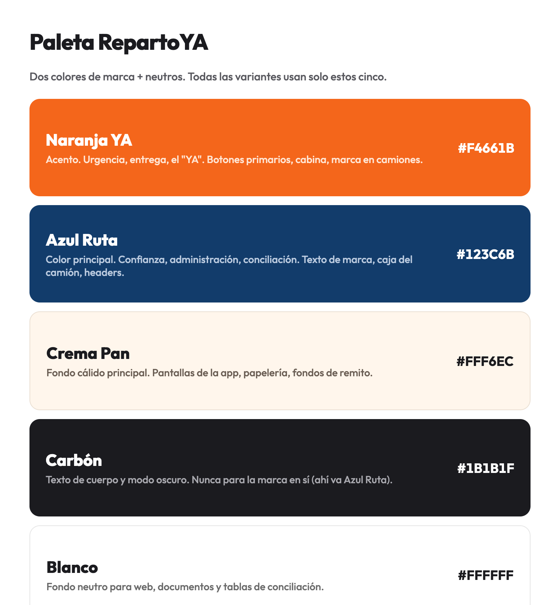
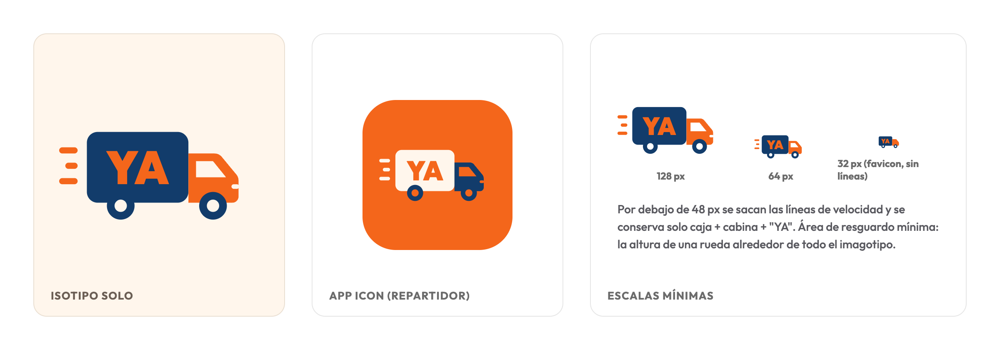
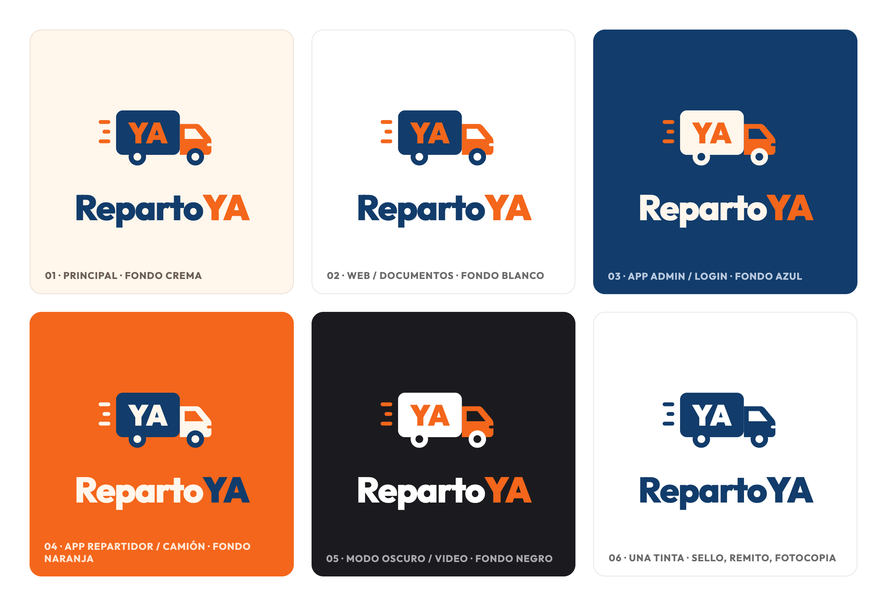

# Manual de Identidad Visual y Guía de Estilo Oficial

<p align="center">
  
</p>

| **Empresa / Consultora:** Softech | **Cliente / Stakeholder:** Martín Rodríguez (RepartoYA) |
| :--- | :--- |
| **Área Técnica:** Frontend Web, Frontend Mobile y Diseño UX/UI | **Versión:** 1.0 (Oficial) |
| **Estado:** Aprobado y Consensuado | **Fecha:** Octubre 2026 |

---

## 1. Propósito y Alcance

El presente documento establece las directrices normativas, técnicas y estéticas del **Sistema de Identidad Visual de RepartoYA**, desarrollado por **Softech** para la plataforma de gestión logística y liquidación de cobranzas tercerizadas liderada por **Martín Rodríguez**.

Su cumplimiento es mandatorio para:
1. **Frontend Transportistas (Mobile):** Aplicación de choferes en calle (rutas, entregas y cobros).
2. **Frontend Administrativos (Web):** Panel de despacho, planificación de itinerarios y conciliación multimarca.
3. **Soporte Físico y Documental:** Remitos de entrega, recibos de cobranza, sellos de recepción y rotulación de flota.

---

## 2. Paleta Cromática Institucional

La identidad cromática de **RepartoYA** se fundamenta en una regla estricta: **dos colores principales de marca más tres tonos neutros de soporte**. Todas las pantallas, interfaces y piezas gráficas deben componerse exclusivamente a partir de estos cinco valores hexadecimales.

<p align="center">
  
</p>

### 2.1. Desglose y Semántica de la Paleta

| Nombre Oficial | Hexadecimal | Rol en el Sistema | Justificación Semántica y Ámbito de Aplicación |
| :--- | :---: | :--- | :--- |
| **Naranja YA** | `#F4661B` | **Color de Acento (CTA)** | Simboliza urgencia, agilidad operativa, entrega en tiempo y forma (el *"YA"*). Se utiliza en la cabina del camión, botones de acción primaria (CTA), switch de confirmación, ícono de la app y rotulación en carrocería de camiones. |
| **Azul Ruta** | `#123C6B` | **Color Principal Institucional** | Transmite solidez, confianza, orden administrativo y conciliación rigurosa. Se utiliza en el texto de marca (*"Reparto"*), la caja de carga del camión, barras de navegación superiores (headers), títulos principales y elementos activos de navegación. |
| **Crema Pan** | `#FFF6EC` | **Fondo Cálido Principal** | Neutro cálido diseñado ergonómicamente para evitar el agotamiento visual en jornadas prolongadas. Se utiliza como fondo por defecto en las pantallas de la aplicación móvil de transportistas, papelería institucional y fondo digital de remitos. |
| **Carbón** | `#1B1B1F` | **Neutro de Lectura y Dark Mode** | Diseñado para textos de cuerpo y superficies en entornos nocturnos/dark mode. Ofrece máximo contraste y legibilidad tipográfica. **Regla mandatoria:** *Nunca se utiliza Carbón para la marca en sí (la marca siempre se aplica en Azul Ruta o Blanco).* |
| **Blanco** | `#FFFFFF` | **Fondo Neutro Puro** | Neutro para el panel web de administración, tarjetas de datos (cards), documentos oficiales, remitos físicos impresos y tablas densas de conciliación y liquidación. |

---

## 3. Anatomía del Imagotipo e Isotipo

El imagotipo oficial de **RepartoYA** combina un isotipo de alto dinamismo con una construcción tipográfica binaria, equilibrando agilidad operativa con rigor administrativo.

<p align="center">
  
</p>

### 3.1. Elementos del Isotipo
1. **Caja de Carga:** Bloque rectangular sólido con vértices ligeramente suavizados, representando capacidad de acopio y custodia de mercadería. Aloja la inscripción central **"YA"**.
2. **Cabina de Conducción:** Módulo frontal ergonómico con parabrisas en contraste, reflejando al transportista y la flota en movimiento.
3. **Líneas de Velocidad:** Tres trazos horizontales paralelos situados a la izquierda de la caja, transmitiendo movimiento ágil, celeridad y despacho continuo.
4. **Conjunto de Rodaje:** Ruedas compuestas por aro exterior sólido y centro contrastante, optimizadas para legibilidad geométrica.

### 3.2. App Icon (Móvil Repartidores)
- **Formato:** Contenedor cuadrado con esquinas redondeadas (*squircle*) adaptado a los lineamientos de diseño móvil modernos.
- **Fondo:** **Naranja YA** (`#F4661B`) para garantizar máxima visibilidad en el cajón de aplicaciones de los teléfonos móviles de los choferes.
- **Isotipo interior:** Caja en **Blanco** (`#FFFFFF`) con inscripción **"YA"** en **Naranja YA** (`#F4661B`), cabina y ruedas en **Azul Ruta** (`#123C6B`), y líneas de velocidad en **Blanco** (`#FFFFFF`).

---

## 4. Escalas Mínimas y Área de Resguardo

Para asegurar la legibilidad del isotipo en cualquier dispositivo y soporte (desde monitores de escritorio hasta pantallas reducidas de smartphones en cabina), se fijan reglas de escala estrictas:

```text
┌──────────────┬────────────────────────────────────────────────────────┐
│   Escala     │ Pautas de Renderizado y Detalle                        │
├──────────────┼────────────────────────────────────────────────────────┤
│   128 px     │ Versión completa: cabina, caja, ruedas, "YA" y líneas. │
│    64 px     │ Versión estándar intermedia: conserva todos los trazos.│
│ 32 px / 48 px│ Microformato (favicon, tab bar): SE QUITAN LAS LÍNEAS. │
└──────────────┴────────────────────────────────────────────────────────┘
```

### 4.1. Regla Mandatoria de los 48 px
> **Directiva de Legibilidad:** Por debajo de **48 px** se eliminan obligatoriamente las tres líneas de velocidad y se conserva exclusivamente: **caja + cabina + "YA"**.
> 
> Esta medida evita el empaste de trazos finos y garantiza que el isotipo sea reconocible incluso a **32 px** (como favicon de navegador o indicador de barra de estado).

### 4.2. Área de Resguardo Mínima (Clear Space)
- Alrededor de todo el imagotipo debe existir un área de protección libre de tipografías, bordes, botones o elementos ajenos.
- **Medida de referencia:** La distancia perimetral mínima equivale a **la altura de una rueda del camión** en los cuatro lados (superior, inferior, izquierdo y derecho).

---

## 5. Matriz de Variantes de Color por Escenario

Para adaptarse a las diversas situaciones operativas del sistema (luminosidad exterior en calle, monitores de oficina, interfaces nocturnas y papelería física), se definen **seis escenarios canónicos**.

<p align="center">
  
</p>

### 5.1. Detalle de Aplicación por Escenario

| N° | Escenario | Fondo | Cabina | Caja | Texto "YA" | Ruedas | Líneas | Logotipo | Uso Principal |
| :---: | :--- | :---: | :---: | :---: | :---: | :---: | :---: | :---: | :--- |
| **01** | **Principal** | Crema Pan (`#FFF6EC`) | Naranja YA (`#F4661B`) | Azul Ruta (`#123C6B`) | Naranja YA | Azul Ruta / Blanco | Naranja YA | Reparto (Azul) + YA (Naranja) | Pantallas generales de app móvil transportistas, onboarding y comprobantes digitales. |
| **02** | **Web / Documentos** | Blanco (`#FFFFFF`) | Naranja YA (`#F4661B`) | Azul Ruta (`#123C6B`) | Naranja YA | Azul Ruta / Blanco | Naranja YA | Reparto (Azul) + YA (Naranja) | Panel web de administración, dashboards de logística, exportación PDF y liquidaciones. |
| **03** | **App Admin / Login** | Azul Ruta (`#123C6B`) | Naranja YA (`#F4661B`) | Blanco (`#FFFFFF`) | Naranja YA | Blanco / Azul | Naranja YA | Reparto (Blanco) + YA (Naranja) | Pantallas de login institucional, pantallas de carga (*splash screen*) y headers institucionales. |
| **04** | **App Repartidor / Camión** | Naranja YA (`#F4661B`) | Blanco (`#FFFFFF`) | Azul Ruta (`#123C6B`) | Blanco (`#FFFFFF`) | Azul Ruta / Blanco | Blanco (`#FFFFFF`) | Reparto (Blanco) + YA (Azul) | Rotulación exterior de camiones y camionetas, chalecos de transportistas y vistas de alerta crítica. |
| **05** | **Modo Oscuro / Video** | Carbón (`#1B1B1F`) | Naranja YA (`#F4661B`) | Blanco (`#FFFFFF`) | Naranja YA | Blanco / Carbón | Naranja YA | Reparto (Blanco) + YA (Naranja) | Interfaces en dark mode, piezas audiovisuales y presentaciones en pantallas de alta resolución. |
| **06** | **Una Tinta (Monocromo)** | Blanco (`#FFFFFF`) | Azul Ruta / Negro | Azul Ruta / Negro | Calado en Blanco | Azul Ruta / Negro | Azul Ruta / Negro | RepartoYA monocolor | Sellos de goma de recepción, remitos físicos autocopiativos y fotocopias blanco y negro. |

---

## 6. Tipografía Oficial y Jerarquía de Texto

La familia tipográfica institucional para todo el ecosistema de software de **RepartoYA** es **Inter**.

### 6.1. Justificación Técnica
- **Legibilidad numérica:** Excelente diseño de cifras y tablas densas, vital para el módulo de arqueo y cobranzas multimarca.
- **Rendimiento y autonomía:** Tipografía de código abierto (SIL Open Font License 1.1) autoalojada en el repositorio (`apps/core/static/core/fonts/inter-latin-wght-normal.woff2`), lo que elimina dependencias de CDN externos y permite operatividad sin conexión (*offline-first*).

### 6.2. Pesos Oficiales y Jerarquías
- **Bold (700):** Títulos principales (`h1`, `h2`), botones de acción primaria e importes totales de liquidación.
- **SemiBold (600):** Subtítulos de sección (`h3`), nombres de comercios/paradas y métricas destacadas de dashboard.
- **Medium (500):** Encabezados de tabla, etiquetas de campo (*labels*) y estados de entrega (*Pendiente* / *Terminada*).
- **Regular (400):** Textos de cuerpo general, descripciones de inconvenientes y observaciones en remitos.

---

## 7. Mapeo Técnico de Tokens de Diseño

Para asegurar la coherencia absoluta entre el diseño y la implementación en código, se definen los siguientes tokens canónicos:

### 7.1. Tokens CSS (`apps/core/static/core/css/paletas.css`)
```css
:root {
  /* Identidad de Marca */
  --color-primary: #123c6b;          /* Azul Ruta (Marca, títulos, headers) */
  --color-accent: #f4661b;           /* Naranja YA (Botón primario, acento de acción) */
  --color-on-accent: #1b1b1f;        /* Texto sobre botón acento */

  /* Superficies y Fondos */
  --color-surface: #ffffff;          /* Blanco (Cards, panel web, tablas) */
  --color-bg: #fff6ec;               /* Crema Pan (Fondo cálido mobile) */
  --color-border: #d1cac3;           /* Borde neutro cálido */

  /* Tipografía */
  --color-text: #1b1b1f;             /* Carbón (Texto de cuerpo principal) */
  --color-text-secondary: #545457;   /* Secundario atenuado */
  --color-text-muted: #6b6b6d;       /* Deshabilitado / Muted */
}
```

### 7.2. Tokens para Aplicación Móvil (React Native / Expo)
```typescript
export const BrandColors = {
  naranjaYa: '#F4661B',
  azulRuta: '#123C6B',
  cremaPan: '#FFF6EC',
  carbon: '#1B1B1F',
  blanco: '#FFFFFF',
} as const;

export const Theme = {
  primary: BrandColors.azulRuta,
  accent: BrandColors.naranjaYa,
  background: BrandColors.cremaPan,
  surface: BrandColors.blanco,
  text: BrandColors.carbon,
};
```

---

## 8. Buenas Prácticas y Usos Prohibidos

Para preservar la integridad visual y el prestigio de la marca del cliente **Martín Rodríguez**, se fijan las siguientes prohibiciones estrictas:

1. 🚫 **No distorsionar proporciones:** Queda terminantemente prohibido alterar la relación de aspecto del isotipo o estirar las tipografías del imagotipo.
2. 🚫 **No utilizar colores fuera de la paleta:** No incorporar tonos de azul o naranja que no correspondan exactamente con `#123C6B` o `#F4661B`.
3. 🚫 **No aplicar Carbón a la marca:** La palabra *"Reparto"* y el camión nunca deben pintarse con Carbón (`#1B1B1F`); su color institucional es Azul Ruta o Blanco.
4. 🚫 **No omitir la regla de los 48 px:** Las líneas de velocidad deben suprimirse en tamaños inferiores a 48 px para evitar manchas visuales y pérdida de nitidez.
5. 🚫 **No invadir el área de resguardo:** Mantener siempre el margen equivalente a la altura de una rueda libre de interferencias gráficas.
6. 🚫 **No invertir combinaciones sin autorización:** Cualquier aplicación en pantalla debe corresponder estrictamente a uno de los seis escenarios normalizados en este manual.

---

<p align="center">
  <em>Manual de Marca y Guía de Estilo Oficial desarrollado por <strong>Softech</strong> para <strong>RepartoYA</strong>. Todos los derechos reservados © 2026.</em>
</p>
