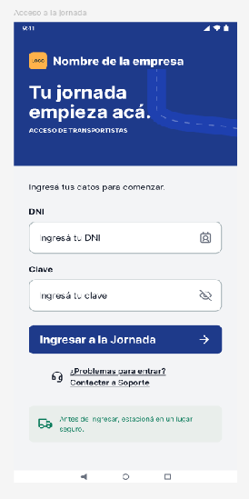

# Minuta de Reunión — Scrum #1 del Sprint 1
**Sesión de Validación y Sincronización con el Cliente**

| **Proyecto:** Sistema de Gestión Logística | **Softech** — Octubre de 2026 |
| :--- | ---: |
| **Identificación del Equipo:** • Carlos, Aylén — 03538/0 • Caruso, Catalina — 03298/4 • Chica Herrero, Ian • Giandon, Enzo Agustín — 03532/4 • Giralde, Lautaro — 03568/7 • Sinion Mendoza, Mayerly • Tolaba, Alan — 4122/3 |  |

- **Empresa:** Softech — Consultoría y Desarrollo de Software  
- **Proyecto:** Sistema Integral de Gestión Logística y Liquidación de Cobranzas  
- **Cliente:** Centro de Distribución Logística  
- **Interlocutor del Cliente:** Martín Rodríguez (Responsable de Planificación Logística y Rutas)  
- **Fecha:** 19 de octubre de 2026  
- **Horario:** 10:00 hs – 10:45 hs  
- **Canal:** Discord (Sala de Coordinación y Validación con Cliente)  
- **Facilitador (Scrum Master):** Enzo Giandon  

---

## 👥 Participantes y Roles

| Nombre y Apellido | Legajo / Identificación | Rol en el Proyecto | Subgrupo / Área |
| :--- | :--- | :--- | :--- |
| **Martín Rodríguez** | — | Responsable de Planificación Logística y Rutas | Cliente / Interlocutor Clave |
| **Enzo Giandon** | 03532/4 | Scrum Master | Gestión Ágil y Facilitación Softech |
| **Alan Tolaba** | 4122/3 | Desarrollador Frontend Web | Front Administrativos (Web) |
| **Ian Chica Herrero** | — | Desarrollador Frontend Web | Front Administrativos (Web) |
| **Catalina Caruso** | 03298/4 | Desarrolladora Frontend Mobile | Front Transportistas (Mobile) |
| **Aylén Carlos** | 03538/0 | Desarrolladora Frontend Mobile | Front Transportistas (Mobile) |
| **Mayerly Sinion Mendoza** | — | Desarrolladora Backend | Backend, Persistencia y APIs |
| **Lautaro Giralde** | 03568/7 | Desarrollador Backend | Backend, Persistencia y APIs |

---

## 🎯 1. Propósito y Objetivos de la Sesión

Esta sesión constituyó el **primer Scrum de sincronización e inspección del Sprint 1** llevado a cabo de manera conjunta entre el equipo de desarrollo de **Softech** y el cliente **Martín Rodríguez**.

Los objetivos fijados para la reunión fueron:
1. Inspeccionar las primeras maquetas interactivas y prototipos de diseño desarrollados en Figma para el panel administrativo web y la app móvil de transportistas.
2. Sincronizar el estado de arranque del modelado de datos en el backend.
3. Recabar la retroalimentación operativa y de negocio directa de Martín Rodríguez para ajustar los criterios de diseño y flujos de interacción antes de iniciar la etapa intensiva de codificación.

---

## 📋 2. Avances Presentados por los Subgrupos de Softech

### 🖥️ Subgrupo Front Administrativos (Alan Tolaba e Ian Chica Herrero)
- **Incremento expuesto:** Proyecto interactivo en Figma que modela las interfaces de usuario preliminares:
  - Pantalla de inicio de sesión único para el personal administrativo (HU-52).
  - Vistas de inicio (dashboards modulares) adaptadas a los distintos roles operativos definidos en la organización:
    1. **Planificación de Rutas:** Área responsable de la diagramación de itinerarios y asignación de hojas de ruta (Figura 1: Vista de la pantalla de inicio de Planificación).
    2. **Conciliación de Pagos:** Área contable encargada del control de cobranzas, arqueos y rendiciones de choferes.
    3. **Administración de Flota:** Gestión del parque automotor, estados de unidades y capacidad de carga.
    4. **Administración de Personal:** Padrón de transportistas, choferes y operadores internos.

### 📱 Subgrupo Front Transportistas (Catalina Caruso y Aylén Carlos)
- **Incremento expuesto:** Prototipo en Figma enfocado en la aplicación móvil para choferes en calle (EP-06):
  - Pantalla de inicio de sesión móvil (HU-23) (Figura 2).
  - Flujos y pantallas correspondientes a los **escenarios fallidos de autenticación** (credenciales inválidas, bloqueo de acceso y validaciones de formato en campo).

  
   
  <em>Figura 2: Vista de inicio de sesión de la app Android.</em>

### ⚙️ Subgrupo Backend (Mayerly Sinion Mendoza y Lautaro Giralde)
- **Estado de avance:** 
  - Inicio de la definición y estructuración de los modelos relacionales de la base de datos en el ORM de Django para soportar las entidades maestras (`Remito`, `Empleado`, `Vehiculo`, `Itinerario`, `Parada`).
  - En esta sesión no se expusieron esquemas ni diagramas de arquitectura de persistencia, enfocándose el subgrupo en consolidar la lógica interna de datos.

---

## 💬 3. Devolución, Observaciones y Comentarios del Cliente (Martín Rodríguez)

Tras la demostración de los prototipos, Martín Rodríguez analizó la propuesta desde la operativa real diaria del centro logístico y formuló las siguientes precisiones mandatorias:

### 1. Estandarización de Estados de Entrega
- **Observación:** En los paneles se observaron diversas etiquetas tentativas para calificar el avance de los pedidos.
- **Definición de Martín:** El estado operativo de una entrega debe clasificarse estrictamente en dos valores posibles: **`pendiente`** o **`terminada`**. 
- **Acción requerida:** Revisar todas las pantallas del sistema; si alguna etiqueta refleja otra denominación (ej. *"en proceso"*, *"cerrada"*, *"en viaje"*), debe reemplazarse inmediatamente para mantener coherencia estricta con el lenguaje del depósito.

### 2. Situaciones Operativas dentro de un Mismo Estado
- **Observación:** El cliente remarcó que las contingencias de reparto no deben confundirse con el cambio de estado global.
- **Definición de Martín:** Cada entrega puede atravesar distintas **situaciones operativas** manteniéndose dentro del mismo estado macro. Por ejemplo:
  - Dentro del estado **`pendiente`**, una entrega puede tener situaciones como *"primera visita sin moradores"*, *"local cerrado temporariamente"* o *"en espera de descarga"*.
  - Dentro del estado **`terminada`**, pueden existir situaciones de cierre como *"entregado con cobro total"*, *"entregado con rechazo parcial"* o *"entrega rechazada íntegra"*.
- **Acción requerida:** Separar en el diseño el campo `Estado` (macro) del subcampo `Situación / Contingencia` de la entrega.

### 3. Señalización y Glosario Explicativo de Etiquetas
- **Observación:** Martín señaló que los administrativos y choferes con distinto nivel de experiencia pueden dudar sobre la implicancia de cada estado.
- **Definición de Martín:** Es fundamental incorporar un aviso visible, leyenda o tooltip contextual que explicite con total claridad qué significa cada etiqueta dentro de la interfaz.
- **Acción requerida:** Añadir ayudas visuales (info-tooltips o referencias al pie de tabla) en el panel administrativo que describan el significado exacto de cada indicador.

### 4. Visualización Simultánea de Flota y Transportistas
- **Observación:** Durante la franja crítica de armado de viajes (4:00 AM a 9:00 AM), el administrativo necesita balancear rápidamente vehículos disponibles contra choferes presentes.
- **Definición de Martín:** Se solicitó expresamente contar con un botón o mecanismo que permita **ver todos los vehículos a la vez del listado de todos los transportistas**, facilitando la asignación cruzada en una única vista comparativa.
- **Acción requerida:** Incorporar en el panel de flota/diagramación una vista paralela o pestaña dividida con la comparativa integral de unidades y choferes.

### 5. Redefinición de la Acción "Intercambiar" en Administración de Flota
- **Observación:** En el prototipo de administración de flota se presentaba un botón rotulado como *"Intercambiar"*, el cual generó dudas respecto a su impacto operativo (¿intercambio de chofer, de unidad averiada, o de carga asignada?).
- **Definición de Martín:** Se debe modificar la indicación y terminología de "intercambiar" en dicha pantalla, aclarando explícitamente qué recursos se están rotando o sustituyendo para evitar errores graves en la asignación vehicular.
- **Acción requerida:** Reestructurar el componente de asignación/relevo vehicular en Figma con una redacción unívoca y pasos claros de confirmación.

---

## 🚀 4. Compromisos y Próximos Pasos por Subgrupo

A partir de las conclusiones de la reunión, se establecieron las siguientes metas inmediatas para el avance del Sprint 1:

| Subgrupo | Responsables | Próximos Objetivos Comprometidos |
| :--- | :--- | :--- |
| **Front Administrativos** | Alan Tolaba, Ian Chica Herrero | 1. Aplicar las correcciones solicitadas por Martín en Figma (estados, leyenda, vista conjunta de flota y choferes, y redefinición de "intercambiar"). 2. Diseñar en Figma el resto de las pantallas administrativas del Sprint 1. 3. Iniciar la codificación de los componentes en React + Vite. |
| **Front Transportistas** | Catalina Caruso, Aylén Carlos | 1. Diseñar en Figma el resto de las vistas de la app móvil (itinerario diario, detalle de paradas, recorridos habituales y cobros). 2. Iniciar la codificación de componentes y pantallas base en React Native (Expo). |
| **Backend** | Mayerly Sinion Mendoza, Lautaro Giralde | 1. Finalizar el modelado completo de entidades relacionales en la base de datos. 2. Coordinar con los equipos de Front Administrativos y Front Transportistas para relevar sus esquemas requeridos y definir los contratos de API. |
| **Scrum Master** | Enzo Giandon | 1. Documentar los acuerdos y asentar las decisiones de producto en el backlog. 2. Facilitar las sesiones de destrabe técnico e integración de contratos entre Frontends y Backend. |

---

## 📌 5. Conclusiones y Registro de Conformidad

La sesión resultó altamente constructiva, logrando validar tempranamente la dirección del diseño de interfaces y previniendo desfasajes conceptuales de negocio en la gestión de estados y asignaciones de flota. El cliente manifestó su conformidad con la modalidad de trabajo y el ritmo del equipo.

- **Próxima Ceremonia:** Scrum Diario N° 2 de Sincronización Interna (Softech).
- **Hito de Entrega:** Demo 1 (MVP Iteración 1) — 30 de octubre de 2026.
