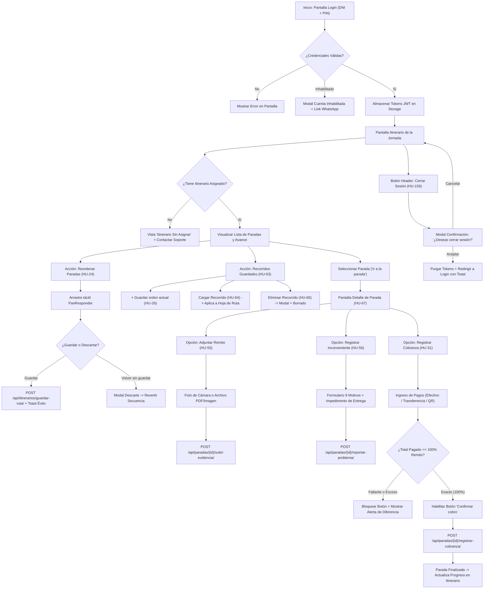

# 📱 Aplicación Móvil de Transportistas — RepartoYA
### Sistema de Gestión Logística, Distribución y Liquidación de Cobranzas

<p align="center">
  
</p>

| **Proyecto Institucional:** Sistema Integral de Gestión Logística y Liquidación de Cobranzas | **Softech** — Sprint 1 & Sprint 2 (Noviembre 2026) |
| :--- | ---: |
| **Cátedra:** Ingeniería de Software<br>**Institución:** Facultad de Informática — Universidad Nacional de La Plata (UNLP) | **Cliente:** Martín Rodríguez (Operaciones Logísticas — RepartoYA)<br>**Zona Operativa:** Zona Sur del Gran Buenos Aires |
| **Subgrupo Técnico Responsable:** Front Transportistas (Mobile)<br>• **Caruso, Catalina** — Legajo 03298/4<br>• **Carlos, Aylén** — Legajo 03538/0 | **Equipo Softech:**<br>• **Enzo Giandon** (Scrum Master)<br>• **Alan Tolaba** & **Ian Chica Herrero** (Front Web)<br>• **Lautaro Giralde** & **Mayerly Sinion Mendoza** (Backend) |

---

## 📑 Tabla de Contenidos

1. [Visión General y Contexto del Negocio](#-1-visión-general-y-contexto-del-negocio)
2. [Matriz de Trazabilidad de Historias de Usuario (Taiga — Sprint 1 y Sprint 2)](#-2-matriz-de-trazabilidad-de-historias-de-usuario-taiga--sprint-1-y-sprint-2)
3. [Especificación Detallada de Historias de Usuario (HU)](#-3-especificación-detallada-de-historias-de-usuario-hu)
   - [Módulo 1: Autenticación, Seguridad y Sesión (HU-23, HU-156)](#módulo-1-autenticación-seguridad-y-sesión)
   - [Módulo 2: Hoja de Ruta, Itinerario y Reordenamiento de Paradas (HU-62, HU-24)](#módulo-2-hoja-de-ruta-itinerario-y-reordenamiento-de-paradas)
   - [Módulo 3: Plantillas de Recorridos Guardados (HU-63, HU-64, HU-65, HU-26)](#módulo-3-plantillas-de-recorridos-guardados)
   - [Módulo 4: Detalle Operativo y Remitos por Comercio (HU-67, HU-25, HU-36)](#módulo-4-detalle-operativo-y-remitos-por-comercio)
   - [Módulo 5: Circuito Financiero y Validación de Cobranzas (HU-31, HU-32, HU-33, HU-30)](#módulo-5-circuito-financiero-y-validación-de-cobranzas)
   - [Módulo 6: Documentación Respaldatoria y Evidencias (HU-55)](#módulo-6-documentación-respaldatoria-y-evidencias)
   - [Módulo 7: Gestión de Contingencias e Inconvenientes (HU-56)](#módulo-7-gestión-de-contingencias-e-inconvenientes)
4. [Arquitectura del Sistema y Flujo Integral del Código](#-4-arquitectura-del-sistema-y-flujo-integral-del-código)
   - [Diagrama de Flujo Operativo End-to-End](#diagrama-de-flujo-operativo-end-to-end)
   - [Capa de Red, Autenticación JWT y Resiliencia Offline](#capa-de-red-autenticación-jwt-y-resiliencia-offline)
   - [Manejo Aritmético de Alta Precisión Monetaria](#manejo-aritmético-de-alta-precisión-monetaria)
5. [Estructura del Proyecto y Organización de Archivos](#-5-estructura-del-proyecto-y-organización-de-archivos)
6. [Sistema de Diseño, Tokens e Identidad de Marca](#-6-sistema-de-diseño-tokens-e-identidad-de-marca)
7. [Suite de Pruebas Unitarias Automatizadas (64 Tests)](#-7-suite-de-pruebas-unitarias-automatizadas-64-tests)
8. [Guía de Instalación, Configuración y Ejecución](#-8-guía-de-instalación-configuración-y-ejecución)
9. [Guía Paso a Paso para Pruebas de Aceptación (Testing Manual)](#-9-guía-paso-a-paso-para-pruebas-de-aceptación-testing-manual)
10. [Créditos y Responsabilidades](#-10-créditos-y-responsabilidades)

---

## 🎯 1. Visión General y Contexto del Negocio

El centro de distribución logística tercerizada liderado por **Martín Rodríguez** opera abasteciendo de productos de consumo masivo (líneas completas de bebidas, cervezas y gaseosas) al canal minorista tradicional de cercanía (**kioscos, almacenes de barrio y autoservicios de proximidad**) en los partidos de la **Zona Sur del Gran Buenos Aires**.

### La Problemática Operativa Previa
- **Coordinación informal y caótica:** Las hojas de ruta, novedades de paradas y cambios de secuencia se gestionaban vía grupos de WhatsApp y anotaciones manuales en papel.
- **Riesgo en la recaudación:** La cobranza en destino involucra grandes volúmenes de efectivo, transferencias bancarias y cobros QR. Frecuentemente se generaban diferencias de caja y descalces entre los remitos entregados y el dinero liquidado al final de la jornada.
- **Rigidez en los recorridos:** Choferes experimentados no podían reordenar sus paradas ante embotellamientos, cortes de calle o comercios con horarios especiales de recepción sin perder el control de su hoja de ruta.
- **Pérdida de comprobantes:** Extravío de remitos físicos con firma o demoras de días en la entrega de las conformidades a la base central.

### La Solución Implementada: RepartoYA Mobile
La aplicación móvil para transportistas constituye el núcleo operativo en calle, desarrollada con **React Native** y **Expo**, integrada al backend **Django REST Framework**:
1. **Autenticación restringida y segura:** Acceso por DNI y clave PIN, con detección inmediata de cuentas inhabilitadas y asistencia por WhatsApp.
2. **Hoja de ruta inteligente:** Visualización del itinerario activo, barra de avance en tiempo real y soporte para transportistas sin asignación.
3. **Reordenamiento táctil de paradas (HU-24):** Capacidad del chofer para adaptar la secuencia de entregas pendientes mediante arrastre táctil fluido, con detección de cambios sin guardar y confirmación en servidor.
4. **Plantillas de recorridos guardados (HU-26, HU-63, HU-64, HU-65):** Guardado de secuencias habituales, consulta de rutas, aplicación directa a la hoja de ruta y eliminación controlada con estados vacíos.
5. **Control estricto de cobranzas multimétodo (HU-31, HU-32, HU-33):** Registro de pagos fraccionados (Efectivo, Transferencia, QR) con validación obligatoria del 100% del importe. Bloqueo de saldos pendientes y excesos.
6. **Digitalización de comprobantes (HU-55):** Captura fotográfica o selección de remitos firmados con previsualización y compresión adaptable.
7. **Gestión formal de contingencias (HU-56):** Reporte tipificado de 9 causas de incidentes (local cerrado, cliente ausente, roturas, rechazos), distinguiendo eventos que impiden la entrega de aquellos informativos.
8. **Cierre de jornada protegido (HU-156):** Confirmación explícita de cierre de sesión con purga de tokens de memoria y bloqueo de retorno por navegación.

---

## 📊 2. Matriz de Trazabilidad de Historias de Usuario (Taiga — Sprint 1 y Sprint 2)

El subgrupo Front Transportistas cubrió el **100% de las Historias de Usuario** asignadas al rol en la plataforma Taiga, distribuidas a lo largo del Sprint 1 y Sprint 2:

| Ref Taiga | Historia de Usuario | Sprint | Estado | Componentes / Vistas Clave | Suite de Tests |
| :---: | :--- | :---: | :---: | :--- | :--- |
| **HU-23** | Iniciar sesión | Sprint 1 | **Done** | [login.tsx](src/app/login.tsx), [authService.ts](src/services/authService.ts) | Integración JWT / Mocks |
| **HU-24** | Reordenar paradas | Sprint 2 | **Done** | [reordenar-paradas.tsx](src/app/reordenar-paradas.tsx), [itinerarios.ts](src/services/itinerarios.ts) | [reordenar-paradas.test.cjs](tests/reordenar-paradas.test.cjs) (13 tests) |
| **HU-25** | Visualizar remitos agrupados por parada | Sprint 1 | **Done** | [parada.tsx](src/app/parada.tsx), [paradaService.ts](src/services/paradaService.ts) | Agrupación multi-remito |
| **HU-26** | Guardar recorrido | Sprint 2 | **Done** | [recorridos-guardados.tsx](src/app/recorridos-guardados.tsx), [itinerarios.ts](src/services/itinerarios.ts) | [recorridos-guardados.test.cjs](tests/recorridos-guardados.test.cjs) (Escenarios 1, 2, 3) |
| **HU-30** | Registrar entrega de remitos | Sprint 2 | **Done** | [validar-cobro.tsx](src/app/validar-cobro.tsx), [ValidarCobro.tsx](src/screens/ValidarCobro.tsx) | [cobranza.test.cjs](tests/cobranza.test.cjs) |
| **HU-31** | Registrar cobranza | Sprint 1 | **Done** | [validar-cobro.tsx](src/app/validar-cobro.tsx), [importes.ts](src/utils/importes.ts) | [cobranza.test.cjs](tests/cobranza.test.cjs) |
| **HU-32** | Validar cobro íntegro | Sprint 1 | **Done** | [validar-cobro.tsx](src/app/validar-cobro.tsx), [itinerarios.ts](src/services/itinerarios.ts) | [cobranza.test.cjs](tests/cobranza.test.cjs) (12 tests) |
| **HU-33** | Finalizar visita según resultado de cobro | Sprint 2 | **Done** | [validar-cobro.tsx](src/app/validar-cobro.tsx), [parada.tsx](src/app/parada.tsx) | [cobranza.test.cjs](tests/cobranza.test.cjs) |
| **HU-36** | Registro de remitos asociados | Sprint 2 | **Done** | [parada.tsx](src/app/parada.tsx), [mockParada.ts](src/data/mockParada.ts) | Verificación de datos de remitos |
| **HU-55** | Adjuntar un documento respaldatorio | Sprint 1 | **Done** | [adjuntar-documento.tsx](src/app/adjuntar-documento.tsx), [AdjuntarDocumento.tsx](src/screens/AdjuntarDocumento.tsx) | [documento.test.cjs](tests/documento.test.cjs) (8 tests) |
| **HU-56** | Registrar inconvenientes con la entrega | Sprint 2 | **Done** | [registrar-inconveniente.tsx](src/app/registrar-inconveniente.tsx), [RegistrarInconveniente.tsx](src/screens/RegistrarInconveniente.tsx) | [inconveniente.test.cjs](tests/inconveniente.test.cjs) (10 tests) |
| **HU-62** | Consultar itinerario | Sprint 1 | **Done** | [itinerario.tsx](src/app/itinerario.tsx), [itinerarioService.ts](src/services/itinerarioService.ts) | Avance y progreso de paradas |
| **HU-63** | Mostrar recorridos guardados | Sprint 2 | **Done** | [recorridos-guardados.tsx](src/app/recorridos-guardados.tsx), [itinerarios.ts](src/services/itinerarios.ts) | [recorridos-guardados.test.cjs](tests/recorridos-guardados.test.cjs) (HU-63 Escenarios 1 y 2) |
| **HU-64** | Cargar recorrido guardado | Sprint 2 | **Done** | [recorridos-guardados.tsx](src/app/recorridos-guardados.tsx), [itinerarios.ts](src/services/itinerarios.ts) | [recorridos-guardados.test.cjs](tests/recorridos-guardados.test.cjs) (HU-64 Escenarios 1 y 2) |
| **HU-65** | Eliminar recorrido guardado | Sprint 2 | **Done** | [recorridos-guardados.tsx](src/app/recorridos-guardados.tsx), [itinerarios.ts](src/services/itinerarios.ts) | [recorridos-guardados.test.cjs](tests/recorridos-guardados.test.cjs) (HU-65 Escenarios 1, 2, 3) |
| **HU-67** | Visualizar detalle de parada y monto | Sprint 1 | **Done** | [parada.tsx](src/app/parada.tsx), [paradaService.ts](src/services/paradaService.ts) | Detalle fiscal y monto exigible |
| **HU-156** | Cerrar sesión | Sprint 2 | **Done** | [itinerario.tsx](src/app/itinerario.tsx), [login.tsx](src/app/login.tsx), [auth.ts](src/services/auth.ts) | Confirmación, purga y toast |

---

## 🔍 3. Especificación Detallada de Historias de Usuario (HU)

### Módulo 1: Autenticación, Seguridad y Sesión

#### 🔑 HU #23: Iniciar sesión
- **Historia:** *Como transportista quiero iniciar sesión en la aplicación móvil para acceder a mi itinerario y comenzar la jornada de entrega.*
- **Reglas del Negocio:**
  - Requiere ingreso obligatorio de DNI y clave numérica (PIN).
  - La cuenta del transportista debe estar activa en Django (`activo: true`).
  - Validación visual en tiempo real: resalta en rojo/alerta el input con error e ícono representativo.
  - Bloqueo preventivo ante usuario inhabilitado: despliega modal emergente con enlace directo a WhatsApp de la Base Logística.
- **Criterios y Escenarios de Aceptación:**
  - *Escenario 1 (Acceso exitoso):* Con DNI `38492011` y PIN `1234`, valida credenciales, almacena tokens JWT y navega a `/itinerario`.
  - *Escenario 2 (DNI inválido/inexistente):* Deniega acceso, resalta campo DNI en rojo y muestra `"El DNI es incorrecto. Intentá nuevamente."`.
  - *Escenario 3 (Clave incorrecta):* Deniega ingreso, resalta campo Clave y despliega `"La clave es incorrecta. Intentá nuevamente."`.
  - *Escenario 4 (Cuenta inhabilitada):* Con DNI `29111222`, abre modal *"Cuenta Inhabilitada"* con botón para derivar a WhatsApp de soporte.

#### 🚪 HU #156: Cerrar sesión
- **Historia:** *Como transportista quiero cerrar sesión en la aplicación móvil para finalizar mi jornada y proteger el acceso a mi cuenta.*
- **Reglas del Negocio:**
  - El botón de cierre de sesión con el ícono corporativo transparente ([icono-logout.png](assets/icons/icono-logout.png)) se ubica en el header del itinerario.
  - Al presionar el botón se debe desplegar un diálogo de confirmación con opciones *"Cancelar"* y *"Aceptar"*.
  - Al confirmar, purga los tokens JWT y datos de sesión en memoria local, redirige al login y bloquea la navegación hacia atrás.
- **Criterios y Escenarios de Aceptación:**
  - *Escenario 1 (Confirmado):* Presiona *"Cerrar sesión"*, confirma en el modal, se limpian los datos, redirige a `/login` con el parámetro `sesionCerrada=true` y muestra un toast flotante *"Sesión cerrada con éxito"*.
  - *Escenario 2 (Cancelado):* Presiona *"Cancelar"*, se cierra el modal emergente y se conserva la sesión activa y el itinerario intacto.

---

### Módulo 2: Hoja de Ruta, Itinerario y Reordenamiento de Paradas

#### 📋 HU #62: Consultar itinerario
- **Historia:** *Como transportista quiero consultar el itinerario de mi jornada para conocer el orden de mis paradas, el progreso de mis entregas y los montos a cobrar.*
- **Reglas del Negocio:**
  - Visualiza el progreso de entregas con barra porcentual en color **Naranja YA**.
  - Tarjeta de la parada inmediata destacada con acción prioritaria `"Ir a la parada"`.
  - Paradas posteriores visibles con orden relativo y botón `"Ver detalle de parada"`.
  - Estado *"Sin itinerario asignado"* con ilustración oficial y botón a soporte cuando el chofer no tiene ruta.

#### 🔄 HU #24: Reordenar paradas
- **Historia:** *Como transportista quiero modificar el orden de las paradas de mi itinerario para adaptar el recorrido a las condiciones reales de la jornada.*
- **Reglas del Negocio:**
  - **Exclusión de paradas entregadas:** Solo se pueden reordenar las paradas en estado `pendiente`. Las entregadas (`completada` / `finalizada`) se mantienen inmutables al inicio.
  - **Interacción táctil fluida:** Implementación mediante `PanResponder` para arrastrar paradas verticalmente con feedback háptico/visual, complementado con controles de flechas para máxima accesibilidad.
  - **Detección de cambios sin guardar:** Barra flotante inferior de advertencia *"Cambios sin guardar"* que habilita el botón naranja *"Guardar orden"*.
  - **Protección contra pérdida de datos:** Si el chofer presiona volver o el botón físico de retroceso con cambios pendientes, se intercepta con el modal *"¿Descartar cambios? Perderás el orden que modificaste"*.
  - **Persistencia en Django:** Al guardar, envía la nueva secuencia al backend (`POST /api/itinerarios/guardar-ruta/`) y despliega el toast flotante *"Nuevo orden guardado"*.
- **Criterios y Escenarios de Aceptación:**
  - *Escenario 1 (Reordenamiento exitoso):* Arrastra una parada a una nueva posición, el sistema activa *"Cambios sin guardar"*, presiona *"Guardar orden"*, confirma en servidor y notifica con toast *"Nuevo orden guardado"*.
  - *Escenario 2 (Cancelar y descartar):* Tras modificar el orden, presiona la flecha atrás, se abre el modal de descarte; al presionar *"Descartar"*, revierte los cambios al orden original sin alterar la hoja de ruta.

---

### Módulo 3: Plantillas de Recorridos Guardados

#### 🗂️ HU #63: Mostrar recorridos guardados
- **Historia:** *Como transportista quiero consultar mis recorridos guardados para seleccionar y reutilizar la ruta que mejor se adapte a mi jornada.*
- **Reglas del Negocio:**
  - Cabecera con contador dinámico de recorridos guardados.
  - Botón principal superior `"+ Guardar orden actual"` siempre visible y accesible.
  - **Estado vacío resiliente:** Si no existen rutas guardadas, muestra la ilustración oficial, el título *"No hay recorridos guardados"* y el texto explicativo de ayuda.

#### 🚀 HU #64: Cargar recorrido
- **Historia:** *Como transportista quiero cargar un recorrido desde "Recorridos guardados" para aplicar ese orden de paradas a mi hoja de ruta actual.*
- **Reglas del Negocio:**
  - Modal de confirmación previo advirtiendo: *"¿Cargar recorrido? Se reemplazará el orden actual de tu hoja de ruta. Podrías perder cambios sin guardar."*.
  - Requiere que el transportista posea una jornada activa asignada.
  - **Feedback visual inmediato según Figma:** Marca la tarjeta seleccionada con una tilde verde de verificación y muestra en la parte inferior el toast flotante: *"Recorrido [Nombre] cargado. Orden de las X paradas aplicado a tu hoja de ruta"*.

#### 🗑️ HU #65: Eliminar recorrido
- **Historia:** *Como transportista quiero eliminar un recorrido de "Recorridos guardados" para descartar rutas obsoletas o que ya no utilizo.*
- **Reglas del Negocio:**
  - Acción destructiva protegida por modal con ícono de papelera, título *"Eliminar recorrido"* y nombre de la ruta.
  - Eliminar una plantilla **no altera** la hoja de ruta en curso de la jornada.
  - Al confirmarse, efectúa la petición a Django, descuenta el contador y muestra el toast flotante en Azul Ruta: *"Recorrido eliminado"*.
  - Si se elimina el último recorrido disponible, conmuta automáticamente al estado vacío de la HU-63.

#### 💾 HU #26: Guardar recorrido
- **Historia:** *Como transportista quiero guardar el recorrido que armé para usarlo de referencia para futuras jornadas.*
- **Reglas del Negocio:**
  - Al presionar `"+ Guardar orden actual"`, abre el modal de registro.
  - **Nombre obligatorio:** Si el campo está vacío o con espacios en blanco, bloquea la acción, resalta el campo con borde de alerta y muestra *"Ingresá un nombre para guardar el recorrido"*.
  - Persistencia con fallback resiliente ante fallas de red y notificación toast *"Recorrido guardado correctamente"*.

---

### Módulo 4: Detalle Operativo y Remitos por Comercio

#### 🏪 HU #67: Visualizar detalle de parada y monto a cobrar
- **Historia:** *Como transportista quiero visualizar los detalles de la parada y el monto a cobrar para obtener información sobre el comercio.*
- **Información Consolidada:**
  - **Comercio:** Razón social, CUIT fiscal, domicilio de entrega y localidad.
  - **Contacto:** Teléfono con botón de enlace directo para llamada telefónica nativa (`Linking.openURL('tel:...')`).
  - **Horario:** Franja horaria pactada de recepción de mercadería.
  - **Monto destacado:** Valor exigible total a cobrar, cantidad de remitos asociados y estado de cobranza (`Pendiente` o `Cobro validado`).

#### 📦 HU #25 y HU #36: Visualización y registro de remitos agrupados
- **Historia:** *Como transportista quiero visualizar los remitos de un mismo comercio en una sola vista para realizar la operación de forma ordenada.*
- Agrupa múltiples remitos de diferentes marcas comerciales bajo la misma parada unívoca, permitiendo verificar cada comprobante y su subtotal correspondiente.

---

### Módulo 5: Circuito Financiero y Validación de Cobranzas

#### 💵 HU #31: Registrar cobranza
- Admite 3 medios de pago oficiales: **Efectivo** (`icono-efectivo.png`), **Transferencia bancaria** (`icono-transferencia.png`) y **Código QR estático** (`icono-qr.png`).
- Permite pagos fraccionados y multimétodo para una misma entrega (ej. parte en efectivo y saldo por transferencia).
- Manejo dinámico de transacciones con opción de eliminar movimientos individuales antes de confirmar.

#### ⚖️ HU #32: Validar cobro íntegro
- **Regla de balance cero estricto:** La suma de los pagos debe ser **exactamente igual al 100%** del valor del remito ($Delta = 0$).
- **Saldo insuficiente:** Si falta dinero, el botón *"Confirmar cobro"* se bloquea y advierte: *"Cobranza incompleta: Faltan $X para cubrir la entrega"*.
- **Saldo excedido:** Si sobra dinero, el sistema bloquea la operación indicando: *"El importe supera el total. Sobran $X. No se genera saldo a favor."*.
- **Cobro íntegro exacto:** Habilita el botón naranja *"Confirmar cobro"* y despliega el panel verde *"Cobranza completa"*.

#### 🛑 HU #30 y HU #33: Finalizar visita y entrega de remitos
- Si el comercio no completa el 100% de la cobranza, la visita no puede cerrarse, no se descargan las bebidas del camión y los remitos no se marcan como entregados. Al completarse el cobro, la parada pasa a estado `finalizada`.

---

### Módulo 6: Documentación Respaldatoria y Evidencias

#### 📸 HU #55: Adjuntar un documento
- **Captura multimodal:** Permite tomar fotografías en vivo con la cámara del dispositivo móvil (`expo-image-picker`) o seleccionar archivos PDF / imágenes desde el explorador del dispositivo o sistema operativo (`expo-document-picker`).
- **Previsualización y control:** Muestra el nombre legible del archivo, extensión y tamaño en KB/MB, con modal de confirmación antes de descartar o sustituir el archivo.
- **Transmisión a Django:** Envío multipart (`POST /api/paradas/{id}/subir-evidencia/`) con persistencia en el modelo `EvidenciaRemito` y redirección a la pantalla de confirmación [DocumentoGuardado.tsx](src/screens/DocumentoGuardado.tsx).

---

### Módulo 7: Gestión de Contingencias e Inconvenientes

#### ⚠️ HU #56: Registrar inconvenientes con la entrega
- **Catálogo tipificado oficial (9 motivos):**
  1. `local_cerrado` — Local cerrado.
  2. `cliente_ausente` — Cliente ausente.
  3. `cliente_rechaza_pedido` — Cliente rechaza el pedido.
  4. `direccion_incorrecta` — Dirección incorrecta.
  5. `problema_pago` — Problemas con el pago.
  6. `mercaderia_danada` — Mercadería dañada / rotura.
  7. `inaccesible` — No se puede acceder al lugar de entrega.
  8. `problema_vehiculo` — Problemas con el vehículo.
  9. `otro` — Otro problema (*requiere obligatoriamente descripción en texto libre*).
- **Indicador de impedimento de entrega:** Casilla de verificación *"¿Este inconveniente impide completar la entrega?"*. Si se marca como impeditivo, la parada pasa a estado `error` y no se liquida como entregada, quedando asentada para auditoría en la Base Logística.
- **Validaciones obligatorias:** Rechaza el envío si no se seleccionó motivo o si el motivo "Otro" carece de texto explicativo. Redirige a [InconvenienteRegistrado.tsx](src/screens/InconvenienteRegistrado.tsx).

---

## 🏗️ 4. Arquitectura del Sistema y Flujo Integral del Código

### Diagrama de Flujo Operativo End-to-End



---

### Capa de Red, Autenticación JWT y Resiliencia Offline

El cliente HTTP reside en [src/services/api.ts](src/services/api.ts):
- **Inyección Automática de Bearer Token:** Interceptor de petición que lee el Access Token almacenado mediante `SecureStore` (o `AsyncStorage` / `localStorage` en entornos web).
- **Cola Concurrente de Renovación (Token Refresh Queue):** Ante un error HTTP 401, el interceptor suspende las peticiones en curso, ejecuta una llamada atómica a `/api/token/refresh/` con el Refresh Token, almacena el nuevo par de credenciales y reintenta transparentemente todas las llamadas encoladas. Si el refresh falla, limpia el almacenamiento y expulsa al usuario al login.
- **Resiliencia y Modo Demostración:** Choferes en calle sufren pérdida recurrente de señal 4G. La suite de servicios en [src/services/itinerarios.ts](src/services/itinerarios.ts) implementa un esquema de **fallback transparente**: ante `Network Error` o servidores inalcanzables, conmuta a los fixtures locales garantizando que la aplicación continúe funcionando sin cierres inesperados.
- **Bloqueo de Concurrencia (Double-tap Prevention):** Colecciones en memoria (`cobranzasEnCurso`, `inconvenientesEnCurso`) evitan envíos duplicados por toques repetidos en botones de acción.

---

### Manejo Aritmético de Alta Precisión Monetaria

En aplicaciones financieras y logísticas, el redondeo por punto flotante de JavaScript (`0.1 + 0.2 === 0.30000000000000004`) es inaceptable.
En [src/utils/importes.ts](src/utils/importes.ts) se diseñó una librería matemática en centavos enteros:
```typescript
// Convierte strings monetarios argentinos ($ 148.500,50) a centavos enteros (14850050)
export function decimalACentavos(valor: unknown): number | null { ... }

// Formatea centavos a representación legible con separadores de miles y decimales
export function formatoCentavos(centavos: number): string { ... }
```
Garantiza que la validación de cobro íntegro (HU-32) sea exacta al centavo sin discrepancias de caja.

---

## 📂 5. Estructura del Proyecto y Organización de Archivos

```text
src/mobile/
├── assets/
│   ├── branding/                # Manual de identidad gráfica RepartoYA y escalas
│   │   ├── isotipo-icon-escalas.png
│   │   ├── paleta-oficial.png
│   │   └── variantes-color-escenarios.png
│   ├── figma/                   # Bocetos de diseño UI y flujos aprobados del Sprint 2
│   ├── icons/                   # Suite de 19 íconos vectoriales minimalistas transparentes
│   │   ├── icono-adjuntar-archivo.png
│   │   ├── icono-alerta.png
│   │   ├── icono-camara.png
│   │   ├── icono-contacto.png
│   │   ├── icono-cuit.png
│   │   ├── icono-dni.png
│   │   ├── icono-domicilio.png
│   │   ├── icono-efectivo.png
│   │   ├── icono-eliminar.png
│   │   ├── icono-horario.png
│   │   ├── icono-logout.png     # Ícono oficial transparente Sprint 2 (HU-156)
│   │   ├── icono-qr.png
│   │   ├── icono-ruta.png       # Ícono oficial transparente Sprint 2 (HU-24)
│   │   ├── icono-rutas-guardadas.png
│   │   ├── icono-soporte.png
│   │   ├── icono-transferencia.png
│   │   ├── psswd-mostrar.png
│   │   └── psswd-ocultar.png
│   └── images/                  # Logotipo principal, isotipo cuadrado y splash screens
├── src/
│   ├── app/                     # Sistema de enrutamiento basado en archivos (Expo Router)
│   │   ├── _layout.tsx          # Configuración del RootLayout y StatusBar global
│   │   ├── index.tsx            # Redirección inicial según estado de sesión
│   │   ├── login.tsx            # Pantalla de inicio de sesión y toast de cierre (HU-23, HU-156)
│   │   ├── itinerario.tsx       # Hoja de ruta, avance y modal de logout (HU-62, HU-156)
│   │   ├── reordenar-paradas.tsx# Vista táctil para reordenar paradas (HU-24)
│   │   ├── recorridos-guardados.tsx # Gestión de plantillas guardadas (HU-26, HU-63, HU-64, HU-65)
│   │   ├── parada.tsx           # Detalle comercial y fiscal de la parada (HU-67, HU-25, HU-36)
│   │   ├── validar-cobro.tsx    # Ruta puente hacia el módulo de cobranzas (HU-31, HU-32)
│   │   ├── adjuntar-documento.tsx   # Ruta puente hacia carga de evidencias (HU-55)
│   │   ├── documento-guardado.tsx   # Confirmación de remito adjuntado
│   │   ├── registrar-inconveniente.tsx # Ruta puente hacia reporte de incidentes (HU-56)
│   │   └── inconveniente-registrado.tsx# Confirmación de contingencia asentada
│   ├── screens/                 # Vistas operativas y formularios modales
│   │   ├── AdjuntarDocumento.tsx    # Manejo híbrido de cámara y selector de archivos (HU-55)
│   │   ├── DocumentoGuardado.tsx    # Vista de comprobante almacenado
│   │   ├── RegistrarInconveniente.tsx# Formulario de 9 motivos de contingencia (HU-56)
│   │   ├── InconvenienteRegistrado.tsx# Comprobante visual de incidente
│   │   └── ValidarCobro.tsx         # Registro multimétodo y cuadre de cobranza (HU-31, HU-32)
│   ├── services/                # Capa de lógica de negocio, integración HTTP y persistencia
│   │   ├── api.ts               # Cliente Axios con JWT Bearer y cola de refresh automático
│   │   ├── auth.ts              # Métodos directos de autenticación JWT
│   │   ├── authService.ts       # Gestión de usuario actual y control de sesión
│   │   ├── config.ts            # Detección dinámica de IP del host y URL base
│   │   ├── itinerarios.ts       # Endpoints de paradas, rutas, cobros, novedades y evidencias
│   │   ├── itinerarioService.ts # Estado local del itinerario y sincronización
│   │   ├── paradaService.ts     # Manejo de parada en curso
│   │   ├── soporteService.ts    # Conexión nativa con WhatsApp de Base Logística
│   │   └── storage.ts           # Almacenamiento seguro multiplataforma de tokens
│   ├── data/                    # Fixtures tipados según modelos Django
│   │   ├── mockData.ts          # Datos mock de transportistas y credenciales
│   │   ├── mockItinerario.ts    # Hoja de ruta asignada y estado sin asignar
│   │   └── mockParada.ts        # Comercio, remitos asociados y montos
│   ├── types/                   # Tipado estricto TypeScript
│   │   ├── api.ts               # Interfaces de modelos Django y DTOs de respuesta
│   │   ├── auth.ts              # Tipos de credenciales y usuario
│   │   ├── inconveniente.ts     # Catálogo de 9 motivos y validaciones
│   │   └── itinerario.ts        # Modelos de parada, itinerario y comercios
│   ├── constants/
│   │   └── theme.ts             # Tokens de diseño oficiales RepartoYA
│   └── utils/
│       └── importes.ts          # Aritmética de centavos de alta precisión
├── tests/                       # Suite de pruebas automatizadas con Node Test Runner
│   ├── cobranza.test.cjs        # Pruebas de cobranzas, centavos y cuadre de caja (12 tests)
│   ├── documento.test.cjs       # Pruebas de subida y validación de evidencias (8 tests)
│   ├── inconveniente.test.cjs   # Pruebas de catálogo de incidentes y validaciones (10 tests)
│   ├── recorridos-guardados.test.cjs # Pruebas de HU-63, HU-64, HU-65 y HU-26 (21 tests)
│   └── reordenar-paradas.test.cjs    # Pruebas de HU-24, PanResponder y descarte (13 tests)
├── package.json                 # Dependencias oficiales Expo / React Native
└── tsconfig.json                # Configuración TypeScript
```

---

## 🎨 6. Sistema de Diseño, Tokens e Identidad de Marca

La aplicación móvil adhiere estrictamente a los lineamientos de marca y diseño definidos en el manual de identidad de **Softech** para **RepartoYA**:

### Paleta de Colores Institucional
- **Naranja YA (`#F4661B`):** Color primario de marca. Utilizado en botones de acción principal (*"Ingresar"*, *"Guardar orden"*, *"Confirmar cobro"*), estados destacados y barras de progreso.
- **Azul Ruta (`#123C6B`):** Color secundario e institucional. Presente en cabeceras de pantalla, barras de navegación, títulos y estados informativos.
- **Crema Fondo (`#FFF6EC`):** Fondo cálido corporativo para pantallas de autenticación, tarjetas de comercios y modales emergentes.
- **Gris Asfalto (`#2D3748`):** Tipografía principal de alta legibilidad en calle con luz solar directa.

```typescript
// src/mobile/src/constants/theme.ts
export const RepartoYA = {
  naranjaYA: '#F4661B',
  naranjaHover: '#D9530D',
  naranjaPastel: '#FFF0E6',
  azulRuta: '#123C6B',
  azulOscuro: '#0D2A4A',
  azulPastel: '#E8EFF7',
  cremaFondo: '#FFF6EC',
  blancoPuro: '#FFFFFF',
  grisAsfalto: '#2D3748',
  grisBorde: '#D1D5DB',
  verdeExito: '#1B873F',
  verdePastel: '#E8F5E9',
  rojoAlerta: '#DC2626',
  rojoPastel: '#FEE2E2',
};
```

---

## 🧪 7. Suite de Pruebas Unitarias Automatizadas (64 Tests)

Para garantizar la máxima confiabilidad técnica y satisfacer las pautas de ingeniería de software de la cátedra, se construyó una suite de **64 pruebas unitarias automatizadas** utilizando el test runner nativo de Node.js (`node:test`).

### Resumen de Suites y Cobertura:

```text
✔ cobranza.test.cjs ............... 12 tests pasados (100%)
✔ documento.test.cjs ..............  8 tests pasados (100%)
✔ inconveniente.test.cjs .......... 10 tests pasados (100%)
✔ recorridos-guardados.test.cjs ... 21 tests pasados (100%)
✔ reordenar-paradas.test.cjs ...... 13 tests pasados (100%)
------------------------------------------------------------
Total: 64 pruebas unitarias ejecutadas exitosamente (0 fallas)
```

### Detalle de Escenarios Validados por Suite:

1. **Reordenar Paradas ([tests/reordenar-paradas.test.cjs](tests/reordenar-paradas.test.cjs) — 13 tests):**
   - Carga inicial y despliegue de cabecera oficial.
   - **Exclusión de paradas entregadas:** Solo se listan paradas pendientes en orden relativo (regla HU-24).
   - Estado inactivo inicial: *"El orden actual está guardado"*.
   - Detección de alteraciones: habilita el aviso *"Cambios sin guardar"* y el botón *"Guardar orden"* (HU-24 Escenario 1).
   - Detección de retroceso con cambios: abre modal de confirmación *"¿Descartar cambios?"* (HU-24 Escenario 2).
   - Opción *"Seguir editando"* conserva las modificaciones; *"Descartar"* revierte la secuencia previa.
   - Envío de secuencia completa a Django y sincronización en memoria.
   - Despliegue de notificación flotante *"Nuevo orden guardado"*.
   - Soporte para gestos de arrastre táctil continuo con `PanResponder`.

2. **Recorridos Guardados ([tests/recorridos-guardados.test.cjs](tests/recorridos-guardados.test.cjs) — 21 tests):**
   - HU-63: Listado de plantillas con contador y estado vacío ante lista sin registros.
   - HU-64: Advertencia de reemplazo en modal, confirmación atómica, marcado con tilde verde y toast flotante *"Recorrido cargado"*.
   - HU-65: Modal de eliminación con ícono de papelera, borrado en servidor, decremento de contador y conmutación al estado vacío al borrar el último elemento.
   - HU-26: Registro de nueva plantilla, validación de nombre obligatorio, persistencia en servidor y modo de simulación offline ante errores de red.

3. **Cobranzas y Cuadre de Caja ([tests/cobranza.test.cjs](tests/cobranza.test.cjs) — 12 tests):**
   - Interpretación de notación monetaria argentina (coma decimal, punto de miles).
   - Aritmética de centavos inmune a errores de punto flotante (`0.10 + 0.20 === 0.30`).
   - Rechazo estricto de cobranzas parciales o excedidas.
   - Bloqueo de concurrencia y protección contra toques dobles.
   - Liquidación de la parada tras confirmar cobro íntegro.

4. **Documentos y Remitos ([tests/documento.test.cjs](tests/documento.test.cjs) — 8 tests):**
   - Conservación de URIs y tipos MIME en capturas fotográficas y archivos PDF.
   - Manejo híbrido de carga multipart nativa y objetos `Blob` en simulador web.
   - Manejo de respuestas HTTP 413 (archivo demasiado grande) y reintentos ante desconexión.

5. **Inconvenientes y Contingencias ([tests/inconveniente.test.cjs](tests/inconveniente.test.cjs) — 10 tests):**
   - Envío de los 9 motivos tipificados al backend Django.
   - Validación obligatoria de descripción libre para el motivo *"Otro problema"*.
   - Registro de indicador booleano de impedimento de entrega y transición al estado `error`.

---

## 🚀 8. Guía de Instalación, Configuración y Ejecución

### Prerrequisitos
- [Node.js](https://nodejs.org/) (versión 20 LTS o superior).
- Administrador de paquetes `npm` (o `bun`).
- Celular físico con [Expo Go](https://expo.dev/go) instalado o emulador Android (Android Studio / SDK).

### Pasos de Instalación

1. **Navegar a la carpeta del frontend móvil:**
   ```bash
   cd "Proyecto_Ing-software/src/mobile"
   ```

2. **Instalar dependencias del proyecto:**
   ```bash
   npm install
   ```

3. **Configurar variables de entorno (opcional para desarrollo local):**
   Copiar [.env.example](.env.example) a `.env`:
   ```env
   EXPO_PUBLIC_BACKEND_URL=http://192.168.1.XX:8000
   ```
   *(Reemplazar `192.168.1.XX` por la IP local de la computadora donde corre el servidor Django para pruebas en celulares físicos en la misma red Wi-Fi).*

4. **Ejecutar el entorno de desarrollo:**
   ```bash
   # Inicia el bundler de Expo
   npm run start

   # Para ejecutar en navegador web (entorno de pruebas rápido)
   npm run web

   # Para ejecutar directamente en emulador Android
   npm run android
   ```

5. **Ejecutar la suite completa de pruebas unitarias:**
   ```bash
   node tests/cobranza.test.cjs
   node tests/documento.test.cjs
   node tests/inconveniente.test.cjs
   node tests/recorridos-guardados.test.cjs
   node tests/reordenar-paradas.test.cjs
   ```

---

## 📋 9. Guía Paso a Paso para Pruebas de Aceptación (Testing Manual)

Para validar todos los flujos de negocio en demostraciones ante la cátedra o el cliente:

### Perfiles de Prueba Preconfigurados:
| Perfil | DNI | Clave / PIN | Resultado Esperado |
| :--- | :---: | :---: | :--- |
| **Transportista Habilitado** | `38492011` | `1234` | **Ingreso exitoso.** Inicia como *Carlos Gómez*, abre hoja de ruta con paradas reales. |
| **Transportista Inhabilitado** | `29111222` | `1234` | **Acceso denegado.** Abre modal *Cuenta Inhabilitada* con botón a WhatsApp. |
| **Credenciales Erradas** | Otro | Cualquier PIN | **Error.** Mensaje indicando verificar DNI o clave. |

### Flujo Operativo Completo:
1. **Acceso (`/login`):**
   - Ingresar DNI `38492011` y clave `1234`. Presionar *"Ingresar a la jornada"*. Navega a `/itinerario`.
2. **Hoja de Ruta (`/itinerario`):**
   - Observar el avance porcentual y las paradas del día.
   - Probar el botón **"Reordenar paradas"** (con ícono oficial de ruta): abre `/reordenar-paradas`.
3. **Reordenar Paradas (`/reordenar-paradas`):**
   - Arrastrar una parada hacia arriba o abajo (o usar los controles de flechas).
   - Observar que aparece el aviso *"Cambios sin guardar"* y se activa el botón *"Guardar orden"*.
   - Presionar la flecha atrás: comprobar que se despliega el modal *"¿Descartar cambios?"*. Presionar *"Seguir editando"*.
   - Presionar *"Guardar orden"*: se guarda la nueva secuencia en el servidor y aparece el toast *"Nuevo orden guardado"*.
4. **Recorridos Guardados (`/recorridos-guardados`):**
   - Desde el itinerario presionar **"Rutas Guardadas"**.
   - Presionar `"+ Guardar orden actual"`: ingresar un nombre (ej. *"Ruta Mañana Bernal"*) y presionar *"Guardar"*. Verificar que aparece el toast *"Recorrido guardado correctamente"* y se suma a la lista.
   - En una tarjeta, presionar *"Cargar"*: confirmar en el modal de advertencia. Verificar que la tarjeta muestra la tilde verde y se despliega el toast *"Recorrido cargado. Orden aplicado..."*.
   - En otra tarjeta, presionar *"Eliminar recorrido"*: confirmar en el modal con ícono de papelera. Verificar el toast en azul *"Recorrido eliminado"*.
5. **Detalle de Parada y Cobranzas (`/parada` y `/validar-cobro`):**
   - Desde el itinerario, presionar *"Ir a la parada"* en la Parada #1 (*Almacén Don Pedro*).
   - Revisar los datos del comercio, CUIT y teléfono con enlace a llamada.
   - Presionar *"Registrar cobro"*: registrar pagos parciales y verificar que el sistema no permite confirmar hasta alcanzar el 100% exacto del valor del remito.
   - Presionar *"Confirmar cobro"*: la parada queda liquidada como finalizada.
6. **Adjuntar Comprobante (`/adjuntar-documento`):**
   - Presionar *"Adjuntar documento"*: seleccionar una imagen o remito firmado. Previsualizar nombre y tamaño. Presionar *"Guardar documento"*.
7. **Registrar Inconveniente (`/registrar-inconveniente`):**
   - Presionar *"Registrar inconveniente"*: elegir uno de los 9 motivos (ej. *"Local cerrado"*), tildar *"¿Este inconveniente impide completar la entrega?"* y confirmar. Verificar que la parada no se computa como entregada.
8. **Cierre de Sesión Seguro (`/itinerario`):**
   - En la cabecera superior del itinerario, presionar el ícono de salida ([icono-logout.png](assets/icons/icono-logout.png)).
   - En el modal *"¿Deseas cerrar sesión?"*, presionar *"Aceptar"*.
   - Comprobar que redirige a `/login`, los campos de DNI y clave están limpios y se despliega la notificación flotante: *"Sesión cerrada con éxito"*. Intentar retroceder en el historial de navegación para verificar que el acceso está bloqueado.

---

## 👥 10. Créditos y Responsabilidades

Módulo desarrollado en el marco de la materia **Ingeniería de Software (UNLP - 2026)** por el subgrupo **Front Transportistas (Mobile)** del equipo **Softech**:

- **Catalina Caruso** — Legajo `03298/4`  
- **Aylén Carlos** — Legajo `03538/0`  

**Articulación con el resto del Equipo Softech:**
- **Enzo Giandon** (Scrum Master): Coordinación ágil, facilitación de ceremonias Scrum, gestión del backlog en Taiga y especificaciones de aceptación.
- **Alan Tolaba** & **Ian Chica Herrero** (Front Administrativos Web): Sincronización del circuito operativo y visualización de paradas y remitos en el panel web.
- **Lautaro Giralde** & **Mayerly Sinion Mendoza** (Backend y Persistencia): Diseño de endpoints Django REST, autenticación SimpleJWT, fixtures del comando `poblar` y modelos de datos.
